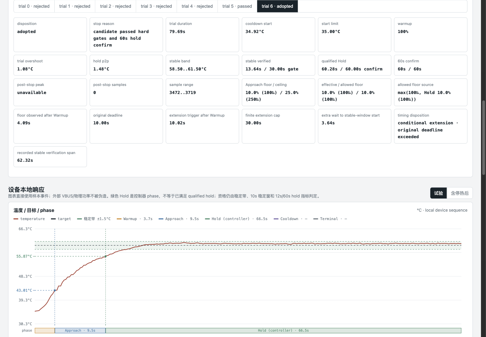
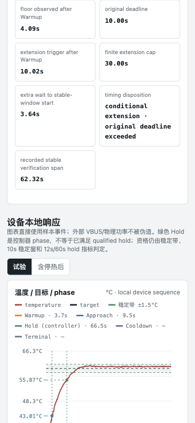
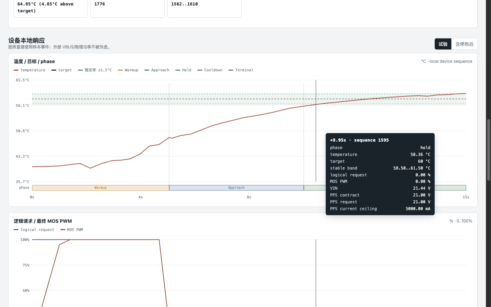
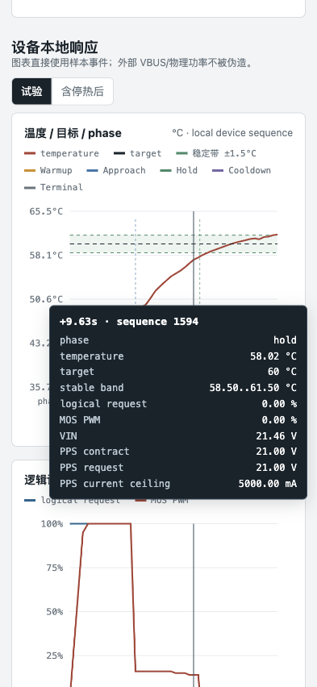
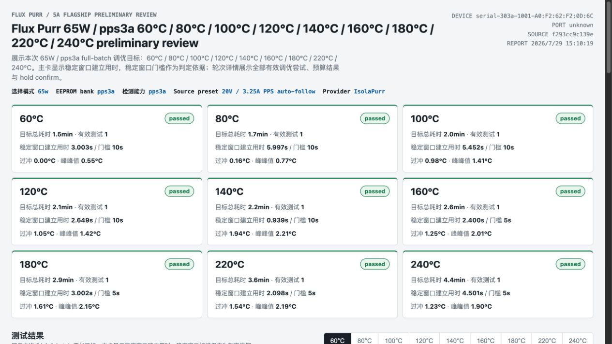
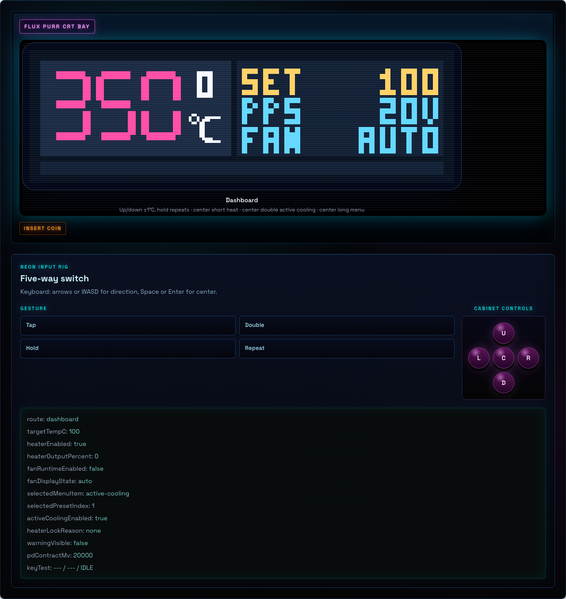
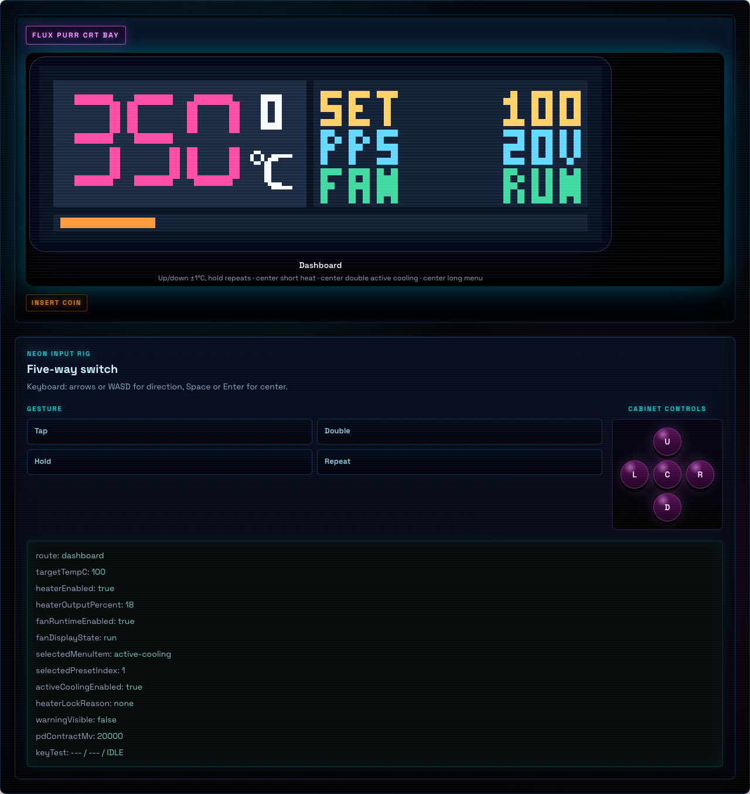
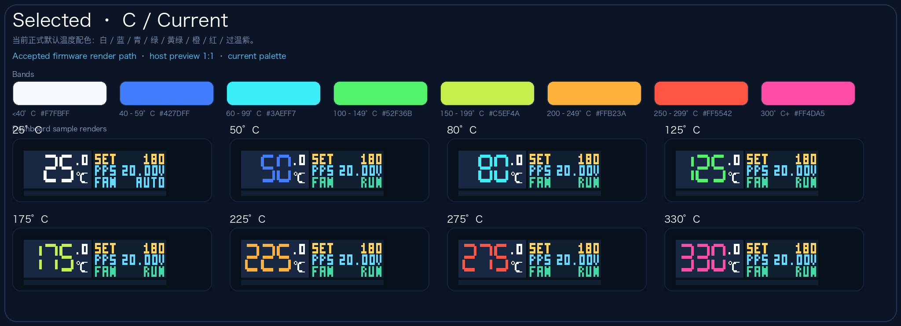

# Flux Purr 正式 PID 加热闭环与前面板运行态同步

## 背景 / 问题陈述

- 当前 `flux-purr` 已完成前面板输入、RTD 读取、FUSB302B PD sink 与 heater/fan bring-up；风扇策略由 POST/HEAT 两个多档设置统一驱动。
- `frontpanel-ui-contract` 与 `frontpanel-input-interaction` 冻结前面板视觉和五向输入基线，运行态风扇状态与保护优先级由本 spec 统一定义。
- 若不把风扇策略、过温停热、feature-selected PD 默认请求与前面板显示一次收口，后续板级调试会持续混淆“策略开关”“实际输出”“保护联动”三套状态。

## 目标 / 非目标

### Goals

- 把 `GPIO47` 固定占空比加热替换为按 `target_temp_c` 驱动的正式闭环；当 FUSB302B 读取到 PPS APDO 覆盖 `20V` 时，heater 后端使用受安全上限约束的 PPS/AVS 粗粒度调压与 `100Hz` MOS PWM 功率合成，否则回退同一 `GPIO47` PWM 调功路径。
- 加热闭环采用模型辅助 ramp/soak 与保温 PI 微调的混合控制器。控制器输出统一的等效热功率请求；PPS 后端映射为 `100mV` 对齐电压，PWM 负责连续的物理功率调节，固定 PD 后端选择不低于目标等效电压的 PDO 并使用同一 MOS PWM 合成等效功率。
- 支持 `ThermalControlProfile` preview 与显式保存。RAM preview 最多 10 个目标点；持久化保存固定为 `pps3a` / `pps5a` 双 bank，各完整保存最多 10 个非空已配置目标点并压紧稀疏槽位。持久化后端只能使用 EEPROM，EEPROM 不可达时进入 `EEPROM_REQUIRED`，不得使用 MCU Flash fallback。`thermalProfileMode` 是 `auto|65w|100w`：auto 仅在 advertised PPS APDO 覆盖 `20V` 且 `ppsMaxMa >= 5000` 时解析 `pps5a`。多个 APDO 覆盖 `20V` 时，必须依次选择较高 `ppsMaxMa`、较高最大电压、较低最小电压的同一 APDO，不得聚合不同 APDO 的能力。显式档位不回退、不阻止运行；PPS/AVS 电压上限继续以所选 APDO 合同为准。preview 始终优先于 selected bank。
- 提供 CLI/devd 自测试入口，抽象 bench source provider；当前默认且验收支持的 provider 是 IsolaPurr released CLI，用于准备 `auto|65w|100w`、PD Fixed enabled、PPS enabled、`auto_follow` 外部 source。单次 live run 工作目录只保留 `run.json`、`samples.ndjson` 与 `thermal-profile.candidate.json` 这类数据文件；owner-facing 冻结 baseline bundle 以浏览器可直接打开的 `index.html` 为唯一 canonical report，并同时提交 `run.bundle.json`、`samples.ndjson` 与 `thermal-profile.accepted.json`。每个 applied stage 的 `analysis` 必须同时沉淀 `approachSource` / `holdSource`，记录 source 实际电压、电流、功率在该窗口内的 `sampleCount`、`min/max/avg/first/last`。当 RTD 进入 fault 时，前面板与 runtime display 必须保留最后一个有效温度显示，不能把 `0°C` 伪装成当前温度；待确认告警由前面板输入或 runtime/CLI/app 的 `faultAttentionAcknowledged` 清除。
- 让 Dashboard 稳定显示实时温度、设定温度、`OFF/AUTO/RUN/SAFE` 风扇显示、策略来源和抽象输出档位。
- 冻结正式风扇/保护包线：
  - `PostHeatCoolingMode` 为 `Off/Normal/Fast`，默认 `Normal`。加热由开到关时，Normal 在高于 `40°C` 运行中风，达到 `40°C` 后以低风运行 `30s`；Fast 在高于 `60°C` 运行高风，`40..60°C` 运行中风，达到 `40°C` 后继续中风 `30s`。
  - `HeatingFanGuardMode` 为 `Off/Low/Medium/High`，默认 `Medium`，仅在 `heater_enabled` 时生效。Low 在超过 `100°C` 后以十秒周期低风脉冲，时间占比从 `1s` 线性到 `5s`（`200°C` 封顶）；Medium 在超过 `80°C` 后从 `1s` 线性到 `5s`（`150°C`），`150..240°C` 固定 `5s` 且输出从低风插值到抽象 `30%`，高于 `240°C` 保持该窗口；High 在超过 `80°C` 后持续低风。
  - 传感器 fault、`>350°C` 停热锁定且至少中风、`>360°C` 高风、`>=420°C` heater hard cutoff 的安全覆盖优先于用户策略。
- 默认启动先建立 active-low 背光控制，再读取稳定的 FUSB302B 身份和可读状态 bank，并在有界 Sink 服务窗口内推进 PD 协商；显示初始化、启动帧刷屏和后续运行时继续以独立的有界 service cadence 处理 PD。只有已观察到 Accept + PS_RDY 的 PPS capability 覆盖 `20V` 时才启用可调加热后端。自动加热的可调请求上限是所选 APDO 的最大电压；`R(T)` 用于估算 heater watts，但不得降低 PPS/AVS 电压请求上限。
- 产出 merge-ready 所需的 spec、视觉证据、板级验证与 review 收敛材料。

### Non-goals

- 不提供任意源码常量热调参入口；运行时调参必须通过 `ThermalControlProfile` 的持久化/API 可控字段完成。
- 不把 `>250°C` 纳入 thermal self-test 或首版调参验收。
- 不实现 fan tach 闭环、4 线 PWM、独立外壳/控制板温度传感器或按 VIN 自动切换固定 PD 请求；只暴露抽象低/中/高输出档位。
- 不修改外部 HTTP / RPC / 持久化字段结构。
- 不扩展新的前面板菜单层级或联网业务逻辑。

## 范围（Scope）

### In scope

- `firmware/src/bin/flux_purr.rs`
- `firmware/src/frontpanel/**`
- `firmware/ram-bringup/src/main.rs` and `flux-purr ram-run`
- `web/src/features/frontpanel-preview/**`
- `web/src/stories/FrontPanelDisplay.stories.tsx`
- `firmware/README.md`
- `docs/interfaces/http-api.md`
- `docs/specs/heater-pid-frontpanel-runtime/**`
- `docs/specs/frontpanel-input-interaction/SPEC.md`
- `docs/specs/frontpanel-ui-contract/SPEC.md`

### Out of scope

- Web 控制台、HTTP API、Wi‑Fi 配置写回字段扩展
- 多电压 / 多功率档位与自动 PD 策略切换
- RTD 额外校准界面或外部校准协议

## 需求（Requirements）

### MUST

- Production heating MUST remain locked until a physically valid thermal plant model is active. A
  protected model-calibration job MAY heat with the bounded bootstrap controller on a PPS APDO
  covering `20V` at `>=3A`; no ordinary runtime request may bypass this lock. `pps3a` / 65 W
  sources use the same active model when their calibrated heater curve provides the required
  temperature-aware power limit.
- Normal heating and firmware tuning MUST use the same calibrated Warmup/Approach/Hold point-local profile controller for both `pps3a` and `pps5a`. A separate 3A plant PI MUST NOT select another production control law or ignore the effective preview/saved/default profile. The calibrated passive-loss function, heat capacity and transport delay are inputs to this shared controller; the requested temperature is its unshifted target.
- Source class selects the independently stored parameter bank and actual available electrical power, never the heating algorithm. A mode flag MUST NOT upgrade a 3A contract to 5A. Source-class or bank changes while armed MUST disarm and reset before re-arming. Temperature-aware resistance, PPS square-root mapping, PWM compensation, current reserve, source capability, sensor faults, model/persistence locks and overtemperature protection remain mandatory; modeled `Pmax(T)` is not measured power. Protected `thermal_plant_auto` remains a separate bounded calibration transient.
- Firmware tuning MUST support the same complete eight-target lifecycle on either power class, with class-bound preview, samples, candidate and save receipts. The same 5% normal Approach minimum, fixed physical Hold entry, timing policy, 3°C thermal gates and independent 60-second confirmation apply. A reduced target set is diagnostic and cannot be saved. Cross-class or cross-Device evidence MUST NOT qualify a candidate.
- RTD divider excitation MUST match the board's electrical configuration independently of user ADC calibration. A uses 3328mV and the repaired B board uses 3340mV; absent user ADC calibration remains absent and uses the documented default mapping. Artifact identity and readback MUST establish the selected excitation before fresh thermal calibration or tuning on that Device. An independent ADC-pin voltage observation does not establish the sensor's physical temperature or justify replacing the measured rail value to force agreement with room temperature.
- Model calibration MUST persist raw RTD ADC observations, ambient raw RTD ADC observations,
  measured heater voltage, duty, and elapsed time. Temperature-indexed heater resistance and
  `kc/kr/Ctheta/tau_d` are derived projections fitted by the device from that trace. The raw trace
  is not rewritten by a separate RTD calibration; a missing or physically invalid projection locks
  heating while retaining the raw data for diagnosis.
- A thermal-loss calibration transaction consists of one bounded transient trace: ambient
  baseline, selected-APDO `max_mv` with `100%` PWM to `220C`, immediate heater disarm, and passive cooling
  to `80C`. It must never enter generic Approach or Hold control. The same trace supplies every
  heater-curve temperature band. When its local physical fit is valid, automatic calibration writes
  it atomically as `active`; it does not require a source-class comparison, a nine-point run, or
  user acceptance.
- At the `220C` cut-off the MOS PWM is the authoritative heater-power disconnect. The selected PPS
  contract remains unchanged through passive cooling so a PD renegotiation cannot disturb RTD
  observations; every cooling sample must record zero duty. The calibration-owned PPS request is
  cleared only after the model transaction is complete, canceled, or failed.
- Transient fitting must derive temperature rate across at least `500ms` while retaining the dense
  early samples for transport-delay and measured-power alignment. Adjacent `50ms` RTD samples must
  not be differentiated directly because ADC millivolt quantization can dominate the physical rate.
- Transient sampling MUST retain every applied-duty edge independently of the sparse temperature-step threshold. In particular, the first zero-duty observation after the 220°C cutoff MUST be recorded even when temperature has not changed. Fitting uses interval energy balances with delayed input power integrated over the same windows as temperature change and passive losses; a single endpoint power must not stand in for an interval average. Two adjacent balances may be averaged to reduce ADC endpoint quantization, but each keeps its own input and loss integral across the cutoff. Measured VIN drift under the fixed calibration PPS request is continuous electrical evidence, not a duty edge. The existing nonnegative physical coefficient bounds and 0.20 residual limit remain mandatory.
- The bounded transient trace reserves time samples for the cutoff response: the first 16 startup observations remain dense, and the first 10 seconds after cutoff retain a sample at each 500ms recording opportunity even when temperature has moved less than 4°C. Temperature-step and duty-edge triggers remain active. This preserves the flat or rising post-cut peak needed to identify transport delay, instead of fitting across a missing multi-second response. The 128-sample limit, passive cooling endpoint, fixed calibration PPS request and coefficient/residual gates remain unchanged.
- Protected thermal calibration timestamps and phase timeouts use elapsed monotonic control time, including delayed frames. The persisted 50ms time grid is a storage unit, not an assertion that every call took 50ms; fractional intervals carry into later cells. Multiple observations in one cell do not create duplicate fit timestamps, and a cutoff edge is retained at the next time cell. The same elapsed clock drives the 500ms post-cut opportunities and fitted capacity, loss and transport-delay units. A new job starts with no timing remainder from a prior run.
- Fitting MUST cache delay-independent temperature/loss balances and cumulative electrical input energy rather than repeat their integration for each delay and coefficient subset. Cache lookup must preserve the direct integral at duty edges, partial intervals and delayed startup. Calibration computation must remain within the existing watchdog/service constraints; extending or bypassing the watchdog is not a fitting remedy.
- The transient job's `20V / >=3A` requirement selects one usable PPS APDO. The powered trace uses
  that APDO's `max_mv` unchanged with `100%` PWM until the `220C` cut-off; heater-curve data, nominal
  `R20/TCR`, and production-profile current reserve settings do not participate in this request.

- The shared profile controller uses monotonic elapsed time between actual control frames for its
  temperature/slope filters, slope units, Hold integral and phase/blend duration. Profile ticks
  retain their one-second meaning. The 50ms scheduling target is not a substitute for observed
  elapsed time; delayed frames must not silently change these parameter meanings. The nominal
  50ms response remains compatible. Disarm, target changes and source-controller changes reset
  the profile clock so an inactive interval cannot accumulate PI state. This normalization does
  not change PD service timing. Protected calibration uses its own elapsed-time clock as specified above.

- HIL host 的 warmup 满功率门禁以 `heaterOutputPercent=100%` 的逻辑命令为主，并要求软启动结束后 `heaterPhysicalOutputPercent >= 99%`。PPS 安全上限更新期间允许物理 PWM 在逻辑命令仍为满功率时短暂落在 `95%..99%`，但该瞬态连续时间不得超过 `2s`；低于 `95%`、持续超过 `2s` 或逻辑命令下降必须拒绝进入候选路径。这样既不把受安全限幅的短暂过渡误判为调优失败，也不掩盖真实的持续欠功率。

- heater 控制周期固定为 `50ms (20Hz)` 的真实单调时间目标，不得用主循环迭代次数或固定累加值虚构 elapsed time。每个周期聚合 `64` 次 RTD ADC conversion，并保留分数毫伏均值，因此 RTD 转换总频率为至少 `1280Hz`；`GPIO47` 在 PPS 与 fixed-PD fallback 全路径统一由 MCPWM 外设输出 `100Hz` PWM。PPS 高于有效 floor 时由受温度/电流合同限制的可调 PD 请求承担粗粒度功率控制并保持 `100%` PWM；PPS 已到 floor 或 bounded down-ramp 尚未到达 floor 时，PWM 必须按请求功率与当前电压等效功率之比连续延伸到 `0%`。每次首次 arm、目标切换或 `Approach -> Warmup` 回退进入预热时，物理 PWM 必须执行 `100ms` 线性软启动。首次进入 HOLD 后，PPS 必须锁定 Approach 建立的交接电压，由 PWM 对 PI 输出做快速响应；不得在 HOLD 内主动向下扫描 PPS。只有持续满 PWM、温度仍低于目标且升温率不足时，才允许以至少间隔 `2s`、单次最多 `500mV` 的步进上调 PPS。运行时 status 必须回显上一轮控制起点间隔 `heaterControlIntervalMs`、RTD 至功率写入完成的执行耗时 `heaterControlCycleMs`、滤波升温率 `heaterFilteredSlopeCPerS` 与 `heaterCoastActive`，供 HIL 判定实际节拍、coast 残余热及恢复供热时机。
- heater使用同一Warmup/Approach/Hold控制器。Warmup保持独立全功率及100ms物理软启动。Warmup→Approach首个请求立即为50‰；随后每周期跟踪独立生成的期望温度与升温率轨迹，不按标定延迟固定等待，也不把温度下降确认作为恢复供热的必要条件。轨迹使用新标定的自然损失、热容量、传热延迟、实际源能力及候选响应参数，正常逻辑请求约束50..1000‰，保留的profile floor/ceiling不钳制它。已施加VIN、物理MOS占空比及电阻曲线估算的供热按真实时间保存，预测供热到达时的温度与升温率；该估计不是电功率实测。模型前馈与同一未来时刻的温度/升温率跟踪误差共同决定新请求。保护仍可立即停热，普通predictive coast不得把Approach置零。Hold参考为最终恒定目标，沿用现有受保护PI。实际温度仍决定固定物理Hold入口与验收；原稳定窗口、条件延长、独立60秒确认和PD/PPS策略保持不变。 候选相对标定参考距离的偏差仍修正实时交接；未观测Hold的低侧失败不得调整Hold参数或截止值伪造有效搜索进展。公式见[自然冷却控制合同](NATURAL-COOLING-CONTROL.md)与[轨迹决定](../../adr/0018-model-generated-temperature-trajectory.md)。
- host 工具必须把 `60 / 80 / 100 / 120 / 140 / 160 / 180 / 220°C` 视为默认 5A full-batch 的同等级调优目标集。物理目标集合始终按升序记录在 `tuningTargetsC`，默认实际执行顺序固定为递归二分的 `60, 220, 120, 80, 100, 160, 140, 180`，并写入 `tuningExecutionOrderC`。调度规则固定为：先调当前区间两端点，再调中点；偶数区间取靠前中点；之后左半区优先、深度优先继续细分。每个目标温度的预算从冷却等待开始计时，单目标总 wall-clock 不得超过 `20min`；`targetTempC < 80°C` 时只能在 `currentTempC <= 35°C` 后启动，外部主控的 `targetTempC >= 80°C` 门槛保持 `currentTempC <= targetTempC - 40°C`；固件主控使用下述 cooldown 合同的分段起点：80–160°C 为目标−40°C，>160–200°C 为目标−30°C，>200°C 为目标−20°C。默认 full-batch 不再额外采集 `0% / 25% / 50%` approach-only 曲线；这些曲线只可作为历史或显式诊断资料，不得进入默认调优流程消耗预算。每个目标的主闭环仍固定为 tuning scout、target-local retune、`current + 一个 evidence-specific predicted point` 的 batch compare，并在单目标预算仍有剩余时持续重复。短 scout 的 p2p 不得额外生成 hold-ripple candidate，任何 scout 或 batch candidate 只有同时满足 dynamic full-speed-to-stable gate、确认裕量、`maxOvershootC <= 3.0°C`、`holdPeakToPeakC <= 3.0°C` 与 `stage completed` 才能进入 `60s` hold confirm。默认 full-batch 流程不得再对调参轮次或 hold confirm 次数设置独立硬上限，唯一默认停止条件是 `completed`、`not_converged`、`candidate_ready`、真实 `budget_exhausted` 或 `environment_blocked`。区间内子目标只有在该区间两侧边界目标都已经 accepted 后才允许开始；未调过的目标只能用最近两侧 accepted 目标点做线性插值生成初始参数。任一目标一旦 accepted，其最终 point 参数必须冻结，后续流程不得回写或共享到其它目标；若某目标在预算内未 accepted，则该目标记为 failed，且该子区间不得继续细分，但其他仍满足边界条件的独立区间可以继续。`ThermalControlProfile` 的调优控制面参数必须 point-local materialize：`warmupReenterCentiC`、`holdEntryCentiC`、`holdExitCentiC`、`holdOnCentiC`、`holdOffCentiC`、`overshootCutoffCentiC`、`holdKpPermillePerC`、`holdKiPermillePerCTick`、`holdBlendTicks`、`holdReheatPowerPermille`、`approachLeadTicks` 与 `holdLeadTicks` 只允许从 point 生效；`settings` 只保留 `tempFilterAlphaPermille`、`approachMaxTicks`、`approachMinPowerRatioPermille`、`autoAdjustableWorkingFloorMv` 与 `heaterCurrentReserveMa`。导入旧 profile 时允许一次性 inflate 旧继承字段，但新写出的 profile、preview request、readback 对齐和 preliminary bundle 都必须使用完整 point-local 值。每轮 active self-test 的 host stage timeout 固定为 `180s`；remaining per-target budget 只允许裁剪冷却等待或阻止开始下一轮，不得把剩余预算反向压缩成更短的 stage timeout 或 warmup timeout。每轮必须回显 `selectedMode=100w`、`resolvedBank=pps5a`、`detectedSourceClass=pps5a`、source telemetry 与 full-speed-to-stable gate。preliminary review bundle 继续使用 canonical HTML bundle：`index.html + run.bundle.json + samples.ndjson + thermal-profile.accepted.json`；顶层必须回显 `kind=thermal_self_test_preliminary_bundle`、`bundleDisposition=preliminary_review`、`acceptedProfileRole=review_candidate_snapshot`、`tuningWorkflow=five_amp_batch`、`tuningTargetsC`、`tuningExecutionOrderC`、`temperatureSemantics`、`candidateDispositions`、`candidateReadyTargetsC` 与 `reportRuns`。`candidateReady=true` 必须同时满足存在可复盘 candidate point、存在有效测试证据、主展示结果 `stage completed`、`maxOvershootC <= 3.0°C`、`holdPeakToPeakC <= 3.0°C` 且 full-speed-to-stable settle time 不超过该目标动态门槛；不得仅因有 point、有样本或预算耗尽前曾产生过候选就标记 ready。每个 raw tuning entry 必须保留在 `targets` / `runs` 并包含 `budgetOutcome`、`timeSpentSeconds`、`roundCount`、`validTestCount`、当前生效参数、轮次参数与评价、温度/控制/source 图表。旧 `preliminary-review-*` 目录或既有 preliminary bundle 的 owner-facing 重写必须走 `flux-purr thermal report rerender-legacy` 这条 Rust CLI 路径。
- preliminary review HTML 的 `reportRuns` 只允许定义每个目标温度的默认主展示 entry，并且必须按物理目标温度升序排列；标题目标列表、summary card 与 target tab 必须使用同一升序目标顺序。页面不得因此省略 raw `runs`。HTML embedded data 必须包含完整 `rawRuns`，并在每个 target tab 内提供 raw entry 切换，使同一目标下该温度自己的 scout、batch candidate、hold confirm 等尝试的 samples、rounds、温度响应、控制输出、source telemetry、参数与评价都可见；`rawRuns` 保留实际执行/审计顺序，不强制按温度排序。
- per-target budget 必须是从 cooldown wait 开始、跨越 scout、每个 batch candidate 与 hold confirm 的单一单调 deadline；batch 内的 candidate 不得重置或穿透该 deadline。deadline 到期时，持有 lease 的 runner 必须先关 heater、释放 lease 并恢复 source，再以 `budget_exhausted` 收口该 target。
- preliminary review 的 owner-facing 结果只允许 `passed` / `failed` 二元分类。每个 raw entry 与 `reportRuns` 主展示 entry 必须包含 `reviewOutcome` 与 `reviewPassed`；`candidateReady=true` 或 `candidateDisposition=acceptance_passed` 映射为 `passed`，其它情况映射为 `failed`。`candidate_ready`、`budget_exhausted_without_candidate`、`environment_blocked`、`not_executed_without_accepted_bounds` 等内部分类只能保留在 JSON 审计字段中，不得作为第三种结果状态，也不得显示在 summary card 主结论区域。
- HTML summary card 与轮次详情 MUST 只显示稳定窗口建立用时 `result.fullSpeedToStable.settleTimeMs` 和稳定窗口门槛 `result.fullSpeedToStable.limitMs`。逼近阶段的起止时间戳仍须保留在 raw JSON/审计数据中供诊断，但不得作为 owner-facing 加热耗时展示；稳定窗口门槛必须单独显示并与建立用时比较，不能把门槛本身当作加热用时。
- owner-facing 的 5A full-batch thermal tuning orchestration 必须走 repo-local `flux-purr thermal tune` Rust CLI；`flagship-tune` 只保留为兼容别名。历史 `scripts/thermal_tuning*` Python 入口已废弃并移出正式执行面；它们不得参与真实 HIL、正式调优、正式报告或验收证据生成。
- 真实 5A flagship HIL 的预检与恢复合同必须固定。启动任一目标前，host 必须先完成 repo-local tuning/report/dynamic-gate 单元测试，使用 repo-local `flux-purr-devd` 绑定明确授权的单一串口，并确认 Flux Purr readback 与 source readback 同时满足 `selectedMode=100w`、`resolvedBank=pps5a`、`detectedSourceClass=pps5a`、`100W`、PD enabled、PPS enabled、`pd_pps_5a=true`、`pps3_limit_ma >= 5000` 与 `tps_mode=auto_follow`。若 source telemetry stale 超过 `2s`、低压卡死、明确的 `SensorShort / SensorOpen / AdcReadFailed`、runtime reset 或硬件无响应，只允许执行同一 source 的 USB-C 断电再上电恢复：`isolapurr power runtime output --enabled false`、确认 `runtime.output_enabled=false` 且 USB-C 已不再出力（`usb_c_actual.status != ok`，或 `usb_c_actual.current_ma=0` 且 `usb_c_actual.power_mw=0`）、等待 `2s`、`isolapurr power runtime output --enabled true`、确认 telemetry 恢复推进，并在重新开始前再次确认授权串口仍是原路径。`runtime.output_enabled` 是 IsolaPurr 运行时电源门控的事实源；`usb_c_power_enabled` 只表示 USB-C path 连接/能力状态，不得单独作为掉电成功判据。掉电期间若 macOS 枚举出其它 Espressif 串口，host 只能记录为证据，不得切换授权端口。温度或 raw ADC 的变化幅度、方向、斜率或连续趋势不得单独触发恢复，也不得单独终止 live stage；`currentTempC`、`heaterFilteredTempC`、固件提供的 `heaterControlTempC` 与 `rtdRawAdcMv` 必须保留在 raw samples。只有固件报告的传感器硬故障、过温、runtime/device、source telemetry、持续采样率故障，或连续超过 `2s` 的固件 `heaterControlMeasurementGuarded=true` 才可将本轮判为环境失败；后者必须保留全部原始样本和 guard 证据，并以 `temperature_sample_glitch` 明确收口。环境失败必须先停热并重新满足该目标的冷却阈值，然后从该目标的完整 stage 重新开始；作废尝试只能写入审计字段，绝不得进入 `applied`、热指标或九点验收。该恢复耗时必须计入同一目标的 `20min` 预算。
- HIL / self-test 的 full-speed-to-stable 硬判定按目标温度动态选择门槛：`targetTempC <= 150°C` 时，从首次离开 `warmup` phase 到首次进入稳定窗口不得超过 `10_000ms`；`targetTempC > 150°C` 时不得超过 `5_000ms`。稳定窗口定义为：后续连续 `10s`、采样频率至少 `3Hz` 的样本中，`abs(currentTempC - targetTempC) <= 1.5°C`；控制器可以在该窗口内短暂使用 `approach` 补偿热损耗，phase 只作为诊断记录而不是物理稳定性的必要条件。超过对应门槛仍未存在已经开始的连续稳定窗口时，host 必须立即停热并以 `full_speed_to_stable_timeout` 结束 stage。脚本必须在每个 stage 的 `fullSpeedToStable.limitMs` 中写出实际使用的门槛，不得依赖人工观察。
- self-test candidate 的在线识别不得在一次失败中同时搜索全部 profile 字段。脚本必须先按 full-speed-to-stable gate、是否进入 hold、overshoot、hold p2p、hold 高低侧误差、source telemetry 与同步样本归类故障，再生成候选。分类至少必须区分 `missed_lower_band_before_limit`、`missed_upper_band_before_limit`、`stable_window_broke_low`、`stable_window_broke_high` 与 `within_gate_low_margin`。`targetTempC <= 150°C` 的 full-speed-to-stable 门槛为 `10_000ms`，确认裕量为 `1_000ms`；`targetTempC > 150°C` 的门槛为 `5_000ms`，确认裕量为 `500ms`。裕量是短测候选排序与直接确认的优先信号，不是最终验收指标：短测已经满足动态 full-speed-to-stable 门槛、`maxOvershootC <= 3.0°C`、`holdPeakToPeakC <= 3.0°C`、stage `completed` 且存在 settle time 时，即使为 `within_gate_low_margin`，也只能进入一次完整 `60s` hold confirm；它绝不得直接成为最终候选或 `passed`。超过动态门槛、过冲超 `3.0°C`、hold p2p 超 `3.0°C`、stage 未 completed 或 settle time 缺失的短测不得进入 hold confirm 或最终候选。首次进入目标带后突破上界时必须增加刹车/lead 并降低低中温 Approach 能量；门槛时仍低于下界时只能渐进式减少刹车、提高 Approach 能量，不得把低中温刹车距离一步压到稳定带边界，也不得直接把 `approachPower / approachFloor` 拉到高功率上限。若已经存在有效 hold 样本且 hold p2p 超线，则不得让 full-speed failure 掩盖 hold ripple；低中温 hold confirm 的过冲或 p2p 失败必须 reseed 下一轮候选，方向为增加刹车/lead、降低 `approachPower / approachFloor`、降低过冲 cut-off 或 reheat 强度，而不是继续用同一短 scout 候选重试。`approachPower / approachFloor` 与 `holdPower / holdReheat` 是独立通道：尚无有效 hold 样本的 approach 失败不得抬高 hold 参数，`holdReheat` 不得被 `approachFloor` 强制抬高。采样、供电、通信或 runtime 故障不得修改 candidate。每次 candidate 更新后，所有运行时影响字段必须 materialize 到 profile 并通过 preview/save API 写入，禁止用替换固件的隐藏常量承载调参结果。
- 固件主控调优的 `scout`、`batch_current`、`batch_predicted` 与 `hold_confirm` 普通路径均执行同一 full-speed-to-stable 硬停止：目标不超过 `150°C` 时门槛为首次离开 Warmup 后 `10s`，更高目标为 `5s`。有限条件例外仅按本节验收标准的已锁定政策执行。门槛约束物理稳定窗口的起点，不是 Approach 标签的持续时间，也不是强制切到 Hold 的时间。生产控制器（普通 5A 加热与固件调优共用）的 Approach→Hold 入口固定使用物理温度门槛，不由候选 `holdEntryCentiC`、`approachMaxTicks` 或超时放宽。`holdEntryCentiC` 仅保留 Approach 曲线、预测 coast 与交接输出 blend 的既有参数作用；实际温度未达门槛必须留在 Approach，超时按试验停止或已批准的有限条件延长处理。入口与 qualified hold 共用同一物理判定：只有实际温度达到 `targetTempC - 0.5°C` 且在目标 `±3°C` 内才能进入 Hold 并开始累计 qualified hold。候选参数不能提前结束 Approach，也不能自行延长稳定窗口起点门槛、代替 qualified hold 或允许超时试验继续加热。门禁必须在每个加热控制周期检查，不得被 `200ms` 报告采样节奏推迟；普通路径门槛内已开始但未验证的稳定窗口中断时也必须停止该轮，条件例外始终受其有限期限约束。停止必须 MOS 关断并进入全速冷却。候选计算只使用停止前真实取得的证据，缺失 hold 指标保持 unavailable，禁止补写实际停止后的保温数据。
- profile preview 必须只驻留 RAM。`runtime_config.thermalControlProfile.op=preview` 需要完整 profile，`op=clear_preview` 清除 preview；`op=save` 需要完整 profile 并写入 persistent active thermal profile，`op=clear_saved` 清除 persistent active profile；状态回显必须暴露 `thermalControlProfilePreview` 区分当前是否处于 RAM preview。
- 低温目标发生 full-speed 低侧缺口时仍必须渐进调节；若缺口不超过 `0.5°C` 且该轮过冲不超过 `1.5°C`、hold p2p 不超过 `2.0°C`，允许把下一轮 approach 增量放宽到 `120‰`、刹车距离减少 `120c`、damping 减少 `180‰`，但仍不得一步提升到满功率，且候选必须重新通过完整安全门禁。
- FUSB302B PPS 电压请求只按 `100mV` 单位对齐；AVS `25mV` 不作为首版 PPS 保温细分路径。
- 目标温度与 preset 写入都必须 clamp 到 `0~400°C`。
- RTD 开路、短路或 ADC 读失败时，heater 必须立即关断并进入测温 fault-latch；这些状态不进入蜂鸣或 attention 状态。`temp >= 420°C` 时进入独立的热失控 fault-latch 与 attention 状态。运行时不得依据 RTD 温度跳变幅度、升降方向、斜率或连续样本趋势推断 `sensor-discontinuity`；正常温度回落和快速升温都必须直接进入控制环。
- 测温 fault-latch 期间 heater 不得自动恢复；测温恢复有效后必须由用户重新 arm。热失控的恢复必须同时遵守绝对温度保护与告警确认规则，不得复用测温 fault 的通用重臂路径。
- FUSB302B 启动只执行身份/状态读取，不发出猜测性 PD 请求；运行时观察到 Accept + PS_RDY 后，只有 PPS APDO 覆盖 `20V` 时才启用 `pps-mos`。多个覆盖 `20V` 的 PPS APDO 必须优先选择最大电流，再以最大电压、最小电压稳定打破平局；固定 `20V` PDO 不得被当作 PPS 覆盖 `20V`。
- `pps-mos` 后端中，控制输出 `0%` 必须关 MOS；HOLD 外若 heater 仍处于 armed 加热会话，则请求以单次最多 `500mV` 的有界步进回到有效工作下限并保持 `0%` PWM；HOLD 内必须保持锁定的 PPS 电压并只将 PWM 降到 `0%`。只有 heater 真正关闭时才恢复 idle Fixed standby（通常为 `5V`，或满足预算的更高 Fixed PDO）；工作态仍不得低于现有 `5.5V` PPS floor。控制输出 `1..100%` 必须映射到 `source PPS minimum .. selected APDO maximum`，并继续受 PPS/AVS capability 上下限钳制；`R(T)` 与 current reserve 不得降低该电压上限。当请求已到工作下限或处于 bounded down-ramp 时，PWM 必须按请求功率与当前请求电压的等效功率比连续补偿到 `0..100%`。WARMUP 必须继续使用动态 PPS 电压表达控制功率。自动控制单次同 APDO 请求变化必须限制为最多 `500mV`；相同 PPS APDO 内的电压变化不得关闭 MOS，请求发出后必须等待至少 `500ms` 才可发出下一次同 APDO 小步请求，使 `300ms` RTD 控制采样稳定窗口有明确余量。只有 PPS/AVS 模式切换、固定 PDO/current-limit fallback、首次模式建立、失败降级或其它离散电源路径变化，才允许先关 MOS；大跨度或模式切换请求使用至少 `275ms` transition window。所有 FUSB302B 可调电压请求在最终写寄存器前都必须 clamp 到不低于 `5V`。不具备合格 PPS APDO 时，fixed-PD fallback 必须通过 `GPIO47` PWM 遵守其协商电流合同；任一关键调压写入失败必须切回默认固定 PD + PWM fallback。
- thermal profile 的 `autoAdjustableWorkingFloorMv` 默认 `5000mV`，可在 RAM preview 或保存 profile 中设为 `5000..28000mV`；运行时有效下限必须取该设置、source PPS capability minimum 与可用 maximum 的安全交集。低于 source capability 的设置不得形成实际请求。
- `GPIO47` 必须在全路径保持 `100Hz` MCPWM。逻辑输出 `0%` 必须立即关断 MOS；PPS 高于 floor 时保持 `100%` PWM，PPS floor 与 bounded down-ramp 区域按等效功率连续调节 `0..100%` PWM，确保物理输出不高于当前控制请求。不得恢复 pulse-density 或软件 GPIO 门控。
- 每个有效 RTD 批次的原始温度必须先独立执行 overtemp 判定；前面板与 owner-facing `currentTempC` / `boardTempCenti` 必须镜像当前有效样本。控制器使用单独回传的 `heaterControlTempC`：除 PPS request 的 `300ms` transition guard 外，仅允许以实际 `20Hz` 周期拒绝超过 `35°C/s` 的单样本物理突跳；该控制侧保护不得修改 raw/human 温度，不得生成 sensor fault，且必须回传 `heaterControlMeasurementGuarded=true`。未被保护的控制样本直接送入 `tempFilterAlphaPermille` 控制的 EMA，不得叠加跨 tick 多样本窗口、中位数、均值窗口或输出钳位。任一传感器 fault 必须立即清空控制器温度状态并保持既有加热关断路径。PPS request 发生变化时，控制温度保持最近可信值，直到 request 连续 `300ms` 未变化；恢复时必须同时重新播种 controller filtered temperature/slope，并重新使用经过控制侧物理门的稳定 RTD 样本。原始 short/open/ADC-read/overtemp 检查在该窗口内仍须逐周期执行。
- 固件主控调优的 `sample.temperatureCentiC`、温度评价与报告必须取与 `currentTempC` 相同的当前 RTD 实测来源，不能取 `heaterControlTempC` 或 EMA/guard 保留值。控制侧 guarded 的有效实测温度仍保留为样本事实；传感器 fault 或非有限温度标为无效。冷却起点准入与终态全速散热释放还必须确认该 RTD 已在当前控制帧被接受，不能利用 guard/transition 保留值或未被当前帧接受的跳变。此等待不重置或暂停原预算，不增加固定稳定等待，不改变生产测温保护、PID 或冷却温度门槛。
- 调优调用方因供电状态终止时，必须在同一安全事件序列中保留触发位置、协议阶段、PD 模块声明的失败、可用性、有效合同及请求的 mV/mA、ticket 是否待确认和该等待的实际年龄，再保留原终止原因。缺失合同标为 `none`，不推测物理掉电或模块故障。该证据不改变 PD 模块、超时、等待规则或安全失效门禁；事件容量不足仍必须关断并标为 `review_incomplete`。
- thermal batch 的默认调优目标固定为 `60 / 80 / 100 / 120 / 140 / 160 / 180 / 220°C`，全部属于同等级调优集合；`250°C` 不参与默认参数调优。默认执行顺序必须采用“端点 -> 中点 -> 左半递归 -> 右半递归”的确定性流程，而不是简单低温到高温顺排。每轮开始前必须主动降温；外部主控调优的重启阈值保持：`targetTempC < 80°C => currentTempC <= 35°C`，`targetTempC >= 80°C => currentTempC <= targetTempC - 40°C`。固件主控调优采用下文的分温区起点。温度首次达到或低于各自阈值且供电就绪后必须立即开始该轮，不得要求回到 `30°C`、不得增加固定 `30s` 或其它稳定等待，也不得跳过冷却。
- `heaterCurrentReserveMa` 作为历史 profile 兼容字段继续保持默认 `200mA`、合法范围 `0..1000mA`，仅用于 fixed-PD PWM fallback；PPS/AVS 路径的电流边界来自所选 APDO 合同，该字段和瞬时 FUSB302B draw 都不得降低 adjustable-voltage request ceiling。
- 已启用加热时，automatic PPS 电压 ticket 的 admission、等待和确认不得冻结 MOS PWM 或回放 admission 时的输出。每个控制周期继续使用最新 PID 请求、使能状态与既有物理 PWM 换算；逻辑请求为零或使能撤销时，MOS 必须在该周期归零。同范围电压过渡等待期间，以旧确认电压与待确认电压的较大值约束物理 PWM；确认后使用新确认电压。需要 blanking 的跨范围/模式过渡仍保持 MOS 关闭并执行原 settling 规则。ticket 超时、失败与 PD 模块契约保持不变；调优冷却的 voltage staging 全程不加热。
- 手动 PPS 覆盖是非持久化调试状态，不写 EEPROM。启用时暂停自动 PPS/PID 电压写入，但 heater/PID 输出与 MOS gate 仍按既有逻辑运行；改压时不得主动干预 MOS gate。
- 手动 PPS 覆盖不依赖 `pps_covers_20v`，但必须存在 PPS APDO capability，目标电压必须在 capability 内、按 `100mV` 对齐且不高于硬件 `28.0V` 边界。FUSB302B 写入失败或 PD 状态丢失时必须自动清除覆盖，回到默认固定 PD 请求或既有 fallback，并通过 status/trace 暴露错误。
- Dashboard fan line 必须显示 `OFF/AUTO/RUN/SAFE`，并由 `fanPolicySource` 与 `fanOutputLevel` 提供运行态事实；旧 `active_cooling_enabled` 只作为兼容投影。
- Dashboard 中键短按只切 heater arm；中键双击不改变风扇策略；中键长按只进菜单。
- `GPIO48` 蜂鸣器必须使用独立 PWM 通道；boot 和 idle 保持静音，不得复用 heater/fan 已占用的 PWM 输出。
- heater 成功切换必须请求 `heater_on / heater_off`；主动降温成功切换必须请求 `active_cooling_on / active_cooling_off`；heater 重臂被拒绝时必须请求 `heater_reject`。请求的实际播放受 `buzzer-cue-arbitration` 仲裁合同约束。
- 任何已接受的前面板用户操作都必须提交提示音请求；其中非 heater / 主动降温专用反馈的已接受操作（如菜单导航、子页进入/退出、预设编辑）统一提交通用 `ui_input` 请求。安全状态可抑制或合并普通反馈。
- 只有仲裁器选中开始播放的蜂鸣器 cue 才从第一拍开始。普通反馈不得重启当前 cue；重复 pending `ui_input` 合并，最新专用反馈替换旧 Pending Feedback。若被选中 cue 的下一有声阶段频率与当前载波相同，GPIO48 的 MCPWM 载波相位必须跨 duty=0 的静音间隙复用。Timer2 必须保持固定 prescaler 并以 period 选择音高；下一有声阶段频率不同时必须先静音并停止 timer，再将计数器归零、应用新 period、重启 timer，最后恢复 duty，不得沿用上一频率段。完整优先级和安全状态合同见 `buzzer-cue-arbitration`。
- 过温保护不得占用 Dashboard 的风扇元素；SET 行必须在告警激活时以 `1Hz` 闪烁 `WARN / OTEMP` 两关键帧。
- `FAN CTRL` 页面只显示可编辑的 `POST` 与 `HEAT` 档位、当前状态、策略来源和抽象输出档位；不得显示 PD、电压、PWM、温度曲线或硬编码规则说明。
- 当前风扇硬件为反相 `FB` 注入控制：`GPIO36 duty=0%` 表示最高风扇轨电压，`GPIO36 duty=100%`（`1000‰`）才表示最低风扇轨电压；所有 `minimum-voltage profile` 语义都必须落到该 `1000‰` 档位。
- 蜂鸣告警只允许存在两个 owner-facing 状态：`热失控` 与 `热失控待确认`。温度 `>=420°C` 的热失控期间必须每隔 `1s` 播放一次热失控提示；温度回落到 `<420°C` 后，若用户尚未确认，则进入待确认状态并每 `10s` 蜂鸣提醒一次。`SensorShort / SensorOpen / AdcReadFailed` 仍可停热并报告测温无效，但不得触发蜂鸣告警、待确认状态或 reminder。
- defmt 日志必须覆盖 RTD 读数、PID 输入/输出、heater backend 选择、PPS/AVS 请求电压、MOS gate 输出、fault 原因、fan policy 输出与 PD 状态变化。
- Dashboard 启动呈现必须区分 `Initializing`、`EepromRestore`、`Ready` 与 `InitialRtdFault` 四态。显示初始化后的首帧必须使用 `---.-°C`、`SET ---`、`PPS ---`、`FAN ---` 占位，不得显示伪造的数值（包括 `300°C`）；可信 v5 EEPROM 配置和首个 RTD 样本有效后才进入 `Ready`。旧格式恢复期间显示真实 RTD 与 `EEPROM/RESTORE`，但锁定配置编辑和加热；PD 未就绪时显示真实 Dashboard 数据与 `POWER/WAIT`。首个 RTD 样本失败时必须显示 `WARN/SENSOR`、保持加热锁定和占位温度；进入 `Ready` 后的 RTD fault 必须保留最后一个有效 owner-facing 温度。
- 启动期间的 USB early-control 必须在启动阶段边界继续提供 `get_identity` 和既有 `startup_busy` 语义；背光控制建立后，固件先执行有界的 PD Sink 启动服务，再初始化显示并提交启动屏，之后才进入其它硬件初始化。PD 合同未就绪时仍必须在该有界窗口结束后继续到 Dashboard，并保持 `POWER/WAIT` 与 fail-closed 门控；显示初始化、启动帧刷屏和后续运行时都必须持续以独立 service cadence 处理 PD。任何被该 cadence 取消的显示 SPI transaction 都必须在 future drop 时释放 CS，不得把面板保持在选中状态。启动屏完成、恢复与网络初始化完成后，USB early-control 必须在进入 runtime loop 前发送 `boot_stage=runtime_ready`。GPIO47 默认保持 `0%`，只有显式 arm 且观察到 FUSB `Accept + PS_RDY` 后才允许输出。

- Approach 初始制动的下降证据 MUST 按观察窗口判断净下降。只有读数超过窗口参考温度0.05°C才重开窗口；低于参考温度的单周期回弹不得清除趋势。连续两次确认仍分别要求窗口≥100ms、下降>0.15°C和滤波斜率≤−0.02°C/s；PPS/RTD重新播种必须清除窗口。不得用逐帧单调下降要求延迟已证实净降温后的模型供热。
- 控制时钟与接受RTD采样的时钟 MUST 分开。PPS稳定等待或异常样本拒绝时，旧控制温度不能再次送入EMA、衰减斜率或增加下降确认次数；下一接受采样按完整间隔计算滤波与导数。控制时钟继续推进状态、制动时间、安全和调优期限。PPS等待同样回传heaterControlMeasurementGuarded=true，不能因保留旧温度或重新播种时间戳而冒充当前周期已接受采样；原始温度和故障检查仍逐周期保留。具体行为见[自然冷却控制合同](NATURAL-COOLING-CONTROL.md)。

### SHOULD

- cooling-disabled lock 的标签与恢复路径保持稳定，便于 monitor 与后续 review 收敛。
- 初始 UI 应在第一次有效 RTD 样本后就显示实际温度，而不是长时间保留 bring-up 默认值。
- firmware preview 与 Storybook 的 Dashboard/Active Cooling 文案和颜色层级保持一致。

### COULD

- 后续在同一条 PID 日志上扩展功率估算或 duty limit 观察字段。

## 功能与行为规格（Functional / Behavior Spec）

### Core flows

- 启动后先识别并初始化 FUSB302BMPX，在有界 Sink 服务窗口内推进 PD Source Capabilities、RDO、`Accept` 与 `PS_RDY`；窗口结束后再初始化显示并提交启动屏。显示初始化、启动帧刷屏和运行时控制面继续以独立的 `5ms` service cadence 处理 PD。若 PPS APDO 覆盖 `20V`，heater 后端进入 `pps-mos`；否则进入 `fixed-pd-pwm-fallback`。
- PD 控制器未识别、启动合同未就绪或运行中合同丢失时，设备仍必须完成 Front Panel Dashboard 与 runtime-ready；`heater_enabled`、校准加热和 `GPIO47` 必须保持关闭，并以 `pd-contract-unavailable` 报告 heater lock。App runtime 在有界 PD 启动服务窗口结束后呈现静态 splash，启动测量完成后再以一次完整 Dashboard SPI flush 覆盖 splash，不得因为 PD 超时再次初始化面板或保留校准首屏；只有 KeyTest runtime 渲染校准场景。只有后续观测到 ready contract 才能解除 heater lock，不能靠保留的 heater arm 自动绕过。
- 用户短按中键后，heater 进入 arm 状态；若无 fault-latch，则控制器按 `target_temp_c - current_temp_c` 输出 `0..100%` 控制量。`pps-mos` 后端在所选 APDO 的最小到最大电压范围内表达该控制量；`R(T)` 参与 `Pmax(T)=min(Vsource^2/R(T), Vsource*Isource)` 的 heater-watt 估算，但不形成电压天花板。只有不具备合格 PPS APDO或关键调压失败时才进入 fixed-PD + `GPIO47` PWM fallback，并按其协商电流合同钳制 duty。
- Dashboard 上/下短按和 hold-repeat 都只调整 `target_temp_c`，每次事件步进 `1°C` 并继续 clamp 到 `0~400°C`；中键 heater / 菜单语义不受 hold-repeat 影响，双击中键无策略副作用。
- 用户双击中键不修改风扇策略；策略只能在 `FAN CTRL` 页面保存。
- Dashboard fan line 显示 `OFF`（策略关闭且无安全输出）、`AUTO`（策略启用但当前无需输出）、`RUN`（策略输出运行）或 `SAFE`（安全覆盖），并同时回传 `fanPolicySource` 与 `fanOutputLevel`。
- 后冷却策略只在 heater 从开到关的边沿启动：Normal 按中风到 `40°C` 后低风 `30s`；Fast 按高风到 `60°C`、中风到 `40°C` 后中风 `30s`。
- 加热防过热只在 `heater_enabled` 时生效：Low/Medium 使用十秒周期低风脉冲并按温度线性插值，High 在超过 `80°C` 后持续低风；Medium 在 `150..240°C` 将抽象输出从低风插值到 `30%`。
- `>350°C` 停热锁定、`>360°C` 高风、`>=420°C` hard cutoff 和传感器 fault 始终覆盖用户策略；用户模式不得降低安全输出。
- PD ready 是 heater 授权前提：合同不可用时必须撤销 heater arm 并将物理输出归零；较低但 ready 的合同仍可按后端限额降级运行。合同从 pending 变为 ready 时，必须丢弃电源不可用期间产生的 heater arm 意图，并等待新的显式 arm；不得因合同恢复自动加热。PPS/AVS 调压写入失败会把 heater 后端降级到固定 PD PWM fallback。
- 手动 PPS 覆盖激活期间，自动 heater backend 不再写 FUSB302B 电压；固定 PD fallback 仍可继续使用 `GPIO47` PWM duty，`pps-mos` 仍可继续由 PID/MOS gate 表达加热输出。
- 温度达到 `420°C` 时，runtime 进入 `热失控`：立即将 heater 输出归零，并每隔 `1s` 播放一次热失控提示。用户可以通过前面板输入或 runtime/CLI/app 的 `faultAttentionAcknowledged` 确认收到告警；确认后停止待确认锁定与强制风扇状态，但温度仍为 `>=420°C` 时，绝对过温保护、停热和 `1s` 热失控提示不得解除。温度回到 `<420°C` 后，若告警已确认则恢复一般状态；若尚未确认则进入 `热失控待确认`，每 `10s` 蜂鸣提醒一次，并拒绝任何 heater arm 请求。强制风扇期间沿用现有主动降温包线：`>60°C` 全速、`40~60°C` 为 `50%`；温度 `<40°C` 或收到告警确认时结束强制风扇状态，两者任一先发生即可。风扇状态解除不等于自动重新 arm heater。
- 前面板 RGB 指示灯必须复用相同的安全真相源：热失控显示红色急闪，已回落但待确认的热失控显示红色单闪；`SensorShort / SensorOpen / AdcReadFailed` 显示紫色双闪，散热关闭过温 lock 显示黄色三闪。普通状态不得覆盖这些灯语。

### Edge cases / errors

- 首次 RTD 采样失败时，heater 必须保持关断，直到后续有效样本恢复且用户重新 arm。
- 测温 fault-latch 期间若用户再次短按中键：
  - 当前测温 fault 仍存在时，必须拒绝重臂并保持 `heater_enabled=false`
  - 当前测温 fault 已消失时，允许清除 latch；该次输入只恢复可用状态，不得同时重新进入 arm
- 热失控告警未确认时，任何 heater arm 请求都必须被拒绝；温度 `<40°C` 只能解除强制风扇状态，不能代替告警确认，也不能解除 heater arm 禁止。
- 热失控告警确认后，若温度仍为 `>=420°C`，绝对过温 fault-latch 必须继续拒绝 heater arm；只有温度 `<420°C` 后才恢复一般状态，heater 保持关闭并等待后续独立的 arm 操作。
- `SensorShort / SensorOpen / AdcReadFailed` 期间 heater 必须保持关断；这些状态恢复后不得生成 `faultAttentionPending` 或蜂鸣 reminder。
- cooling-disabled lock 清除后，若温度仍高于 `350°C`，必须等待温度回到 `<=350°C` 再次越线后才允许重新触发锁定。
- `热失控待确认` 期间，第一次任意输入只能作为确认/静音；该输入不得顺带切 heater、切主动降温或发生页面导航。

## 接口契约（Interfaces & Contracts）

### 接口清单（Inventory）

| 接口（Name） | 类型（Kind） | 范围（Scope） | 变更（Change） | 契约文档（Contract Doc） | 负责人（Owner） | 使用方（Consumers） | 备注（Notes） |
| --- | --- | --- | --- | --- | --- | --- | --- |
| `FrontPanelUiState.dashboard_presentation` | Rust state model | internal | New | None | firmware | runtime / preview / render tests | `Initializing` / `EepromRestore` / `Ready` / `InitialRtdFault` 启动呈现合同 |
| `FrontPanelUiState.fan_display_state` | Rust state model | internal | New | None | firmware | runtime / preview / render tests | Dashboard 风扇三态真相源 |
| `FrontPanelUiState.heater_lock_reason` | Rust state model | internal | New | None | firmware | runtime / preview / render tests | `sensor-fault` / `pd-contract-unavailable` / `cooling-disabled-overtemp` / `hard-overtemp` |
| `FrontPanelUiState.dashboard_warning_visible` | Rust state model | internal | New | None | firmware | runtime / preview / render tests | SET 行告警闪烁相位 |
| `FrontPanelUiState.manual_pps_enabled` | Rust state model | internal | New | None | firmware | runtime / preview / render tests | Dashboard `PPS*` 调试覆盖提示 |
| `ThermalControlProfile` | USB/devd runtime config + persistent memory config | external | New | `docs/interfaces/http-api.md` | firmware / devd | CLI / devd / Web Serial | RAM preview 与 persistent saved profile，最多 10 个点；每点同时携带 power baseline 与 damping 字段 |
| `Status.faultAttentionPending` | USB/devd runtime status | external | Updated | `docs/interfaces/http-api.md` | firmware / devd | CLI / Web / tuning runner | 仅表示热失控已回落且尚未确认；测温 fault 不得置位 |
| `RuntimeConfig.faultAttentionAcknowledged` | USB/devd runtime config | external | Updated | `docs/interfaces/http-api.md` | firmware / devd | CLI / Web / tuning runner | 确认热失控告警；不得绕过 `temp >= 420°C` 的绝对停热与 `1s` 提示 |
| `FrontPanelRuntimeState` / `FrontPanelScreen` | TypeScript type | internal | Updated | None | web | Storybook / preview harness | 对齐 firmware 四态启动呈现、三态 fan 与告警关键帧 |

### 契约文档（按 Kind 拆分）

None

### 固件主控 5A 调优

- firmware engine 在 `160/180/220/240°C` 上具有明确的冻结策略例外：设备温度证实高侧越带/高侧未入带，且未验证窗口的 full-speed-to-stable 门槛失败，或热指标任一（过冲、qualified Hold 峰峰值、入口余热）超过 `3°C` 时，优先使用既有保守减能候选，不由 `Underpowered` 标签反向增加请求。稳定失败与 `3°C` 热指标是独立触发条件；已验证窗口后的普通离带不能单独触发此例外。scout/batch 与确认失败的 reseed 都先检查这一完整高侧证据；未命中时继续原确认投影和修正。通常配置 floor/ceiling 各减 `100‰`、Hold/reheat 各减 `50‰`、brake 加 `3°C`，严重度至少 `20°C` 时沿用 `180‰`/`5°C` 变换，全部边界和截止约束保留。effective floor 仍由生产路径计算并绑定 trial；holdEntry/holdExit 的曲线调整不改变固定物理入口。低侧、缺失证据、安全失败及 `<=150°C` 不因这个例外改变。外部主控策略保持冻结；这些高侧输入须验证有意差异，不宣称与外部逐值一致。完整稳定窗口、条件延长前提、热指标、独立 `60s` 确认和持久化身份门禁全部保留。
- `thermal tune --engine firmware` 支持 `pps3a` 和 `pps5a` 的同一调优流程。默认资格范围为 `60 / 80 / 100 / 120 / 140 / 160 / 180 / 220°C` 八个同等级目标，实际执行顺序为 `60, 220, 120, 80, 100, 160, 140, 180`；缩小范围的诊断/复测不能产生默认资格通过或保存结论。240°C 不属于调优目标，调优入口必须拒绝该目标；正常加热温度上限、独立物理模型标定和历史报告不受目标集裁减影响。两个电源类别的候选与保存分别绑定对应 bank 和 Device。
- 固件调优的加热试验只在有效 `pps5a` PowerState、可用 thermal model、无标定/preview 互斥及有效安全状态下启动。设备处于正常 Fixed idle 合同时，若同一 PPS APDO 已证实支持20V/5A、选择100w/pps5a且模型和安全门禁满足，启动命令可进入 MOS 关闭的 cooldown 电源准备阶段；调用方申请现有工作合约并按每张 ticket 的5.5秒上限等待，真实 PPS/5A 未确认前不得记录合格试验样本或进入 Warmup。输入命令在同一循环内启动调优后，必须在首次控制与采样前重新建立电源等待门禁，不得把上一轮的 Fixed idle 观测投影为 PPS 调优样本。调优运行期间的零 MOS 输出不是普通 Idle Operation，idle 和 fan-only 供电策略不得覆盖调优工作电源请求。热控运行循环和前面板显示分别持有 PowerState 订阅；显示刷新不得消费热控的变更通知，调优采样的合同必须来自热控订阅的最新完整状态。候选仅在安全 trial boundary 通过既有 RAM preview 生效，5A 正常加热与调优均使用同一 point-local profile 控制器；PPS/PWM 映射及所有保护保持现行路径。不得另建调优专用加热状态机、功率公式、隐藏输出限幅或改变 `thermal_plant_auto` 单次受保护瞬态语义。
- 固件调优和加热控制必须把 PD 请求的 `Pending` 与终态失败分开处理。已接纳的请求必须保留并消费 ticket；在 PD 的 `WaitingForAccept` / `WaitingForPsRdy` 窗口内不得把缺少 ready observation 直接记为 `pd_contract_lost`，也不得重复提交同一请求。等待期间物理 PWM 必须保持安全关闭，调用方使用不超过 PD 请求超时加裕量的有界等待；只有 `Confirmed`、`Rejected`、`TimedOut`、`TransportFault`、`Detached`、`Superseded` 或明确的供电状态失效才能结束该等待。确认后必须校验电压、电流和 PPS 模式与请求完全一致，失败或超时不得产生调优通过结论。
- 固件调优的 cooldown 同时是 heater-off PPS 准备阶段：物理 MOS 始终为 `0`，风扇全程无视普通 `Off/Normal/Fast` 后冷却设置而全速运行（`fanEnabled=true`、`fanOutputLevel=high`，现行反相硬件为 `GPIO35=high`、`GPIO36 duty=0%`）；过温安全状态仍须保留其 `safety` 来源。60°C 调优终止后保持 MOS 断开和全速风扇，直到有效测温 `<35°C` 或新的正常加热开始；其它目标的终止后释放门槛保持 `<=40°C`。无效测温不得误解除冷却。自动请求沿现有单次最多 `500mV` 的 PPS 步进达到所选 APDO 上限；请求电压和已确认 5A 合同都达到该上限，且温度冷却门槛满足后，才允许进入下一 trial 的 warmup。固件主控所有 trial 的起点以设备本地当前已接纳实测温度为准：目标 `<80°C` 时为 `<=35°C`；`80°C <= 目标 <=160°C` 时为 `<=目标-40°C`；`160°C < 目标 <=200°C` 时为 `<=目标-30°C`；目标 `>200°C` 时为 `<=目标-20°C`。首次、重试、batch current/predicted 与独立确认共用这一规则；160°C 仍从120°C或以下开始，180/220/240°C 分别从150/200/220°C或以下开始。trial 事件与标准报告保留当时实际起点及阈值，历史记录不得按新阈值改写。起点调整不延迟生产 Warmup 制动切换，不改变阶段入口、稳定窗口或热指标门禁；Warmup 时长由实际样本复核。外部主控的温度门槛、冷却零输出、PPS 就绪或单目标预算保持不变。调优仍在运行时不得因 cooldown 把已准备好的高压合同主动降回 idle `12V`。每张已接纳的 PD ticket 各自受 PD 请求超时加裕量约束，连续成功的步进不得共用首张 ticket 的截止时间；完整 PPS 准备等待仍计入原有单目标 `20min` 预算。拒绝、单张 ticket 超时或供电失效仍按安全失败收口，不得把准备期间的物理 PWM 降额样本计入 warmup 评分。
- 固件调优的决策与报告记录器使用设备本地 `200ms` 最小记录间隔，为控制周期量化和调度延迟留出满足至少 `3Hz` 实测采样率的余量；该请求间隔不得替代稳定窗口的真实时间戳与样本数量判定，生产热控 tick 不降频。100ms 软启动期间到首次满物理输出之前，每个生产控制 tick 的样本均须保留，以便原始证据能区分逻辑满请求与物理爬升。每个 tick 仍须检查样本身份、PPS 合同、测温有效性与 cooldown 零输出，phase 切换须立即记录，不得因审计节拍延迟失效关热。
- `holdConfirm=true`、`adopted` 和 `freeze=true` 只可由目的为 `hold_confirm` 且通过完整独立 `60s` 确认的试验产生。scout 或 batch 即使实际采样超过 60 秒，也只可通过短试验门禁，不能替代独立确认。Rust 与 Web 报告投影保留每轮 `targetC`、`trialPurpose` 和原始处置；试验与 decision 的目的不一致或缺失时，不得显示确认通过或提供保存资格，不能改写原始设备 ledger 来掩盖错误。
- 主机在运行读取失败后必须先请求取消，再在有界终态恢复窗口内读取同一 `runId` 保留的尾部事件；取消响应中的重复页不代表尾部已取完。只有设备确认该运行已 disarm 后才可继续终态读取；ACK 游标只能推进到已持久记录的事件，完整尾部还须确认最后 sequence。恢复不能重臂、重试加热或清除原始失败：即使序列和 digest 恢复完整，主结论仍为 `failed` 且保留主机中断原因；覆盖、缺口、身份不匹配、无进展或恢复超时须保留 `review_incomplete`，不得制造完整证据。
- 5A 决策策略以当前主干外部主控 `thermal tune` 为冻结向量基线：目标顺序、冷却温度门槛、最近两侧已 accepted 点的 seed/线性插值、target-local scout/retune、current 与 evidence-specific predicted compare、完整 score vector、hard gate、单目标从 cooldown 开始的 `20min` 单调预算、失败区间阻断、accepted point 冻结、无默认独立轮次硬上限及 `60s` hold confirm 必须一致。固件 cooldown 全程全速散热及 60°C 终止后持续冷却到 `<35°C` 由本主题的风扇约束单独锁定。设备缺少的外部 source 实测不得伪造；无法由本地 PPS/安全事实映射的向量应明确 unavailable 并失败，而非更改评分或通过门槛。每个固件 `candidate_trial` 必须保留 `startTemperatureCentiC` 与 `cooldownThresholdCentiC`，标准报告的对应 trial 必须在 `cooldownGate` 中保留这两个原始 centi-C 值并随试验切换显示；旧证据缺少字段时标为 `unavailable_device_trial_record`，不得按当前策略倒填。
- 5A 候选比较必须包含外部策略的 evidence-specific 优先级：当低中温 trial 的过冲、hold 峰峰值或 hold 入口剩余热量任一超过 `3°C`，并且出现“门槛内进入目标带后从高侧离开”或“门槛时仍未进入目标带的高侧缺口”任一事实时，须优先比较增加刹车并降低逼近能量的保守候选，不能让曲线的 `underpowered` 标签单独把高侧失败转成减小刹车、提高逼近能量。门槛时仍低于稳定带下界的 `missed_lower_band_before_limit` 必须走低侧渐进修正，减少刹车并提高 Approach 能量；不得套用保守高侧候选。已完成 scout、验证稳定窗口、过冲 `<=3°C` 而 hold 峰峰值在 `(3,4]°C` 时，须优先比较只调整 hold PI/过渡的波动修整候选；未验证稳定窗口不得套用该专用分支。候选仍在 trial boundary 通过 RAM preview 生效，所有原有 hard gate 不变。
- 确认失败后的候选生成必须对齐冻结外部主控的 `reseed_after_failed_hold_confirm`，使用 stage metrics/guard 的基础修正，再按完整审计事实施加专用 confirmation nudge；不能把 scout 的 evidence-specific candidate、batch gate nudge 或 step bound 直接用作确认 reseed。外部基础修正的 stage 解析不携带 curve/hold analysis，这一输入投影与专用 nudge 使用的完整事实必须分别保留，不得因此丢弃报告证据。Hold 门槛 crossing 必须同时观察 Approach 和首次进入 Hold 后的样本，避免跨 phase 的采样遗漏把 hold gate lag 错分为未进入 Hold 的低侧 miss。Celsius 差值和 rounded reseed step 必须通过真实采样及高低侧向量与冻结路径差分验证；缺失 Hold 证据不能作为已验证低波动的资格事实。通过的短 scout 候选仍须被选中并重新执行 `60s` confirmation，确认失败只触发同一 target 内的 reseed，不得直接升格或保存。
- 每个 candidate 的 warmup 逻辑请求必须达到 `100%`，有完整 approach→hold、过冲 `<=3°C`、hold 峰峰值 `<=3°C`、目标相关 full-speed-to-stable 门槛与连续 `60s` hold confirm。固件试验与外部主控调优使用相同的 hold 观察起点：控制 phase 已进入 Hold、设备温度不低于目标减 `0.5°C`，且与目标的绝对温差不超过 `3°C`；只有从这一样本开始才统计 hold 峰峰值、控制输出与连续 `12s` scout / `60s` confirm，起点后的离带样本仍须计入，不得以 phase 切换时刻提前开始。前一候选、rejected trial 和 cooldown 样本不得计入 adopted candidate 的评分；实际 MOS PWM 与逻辑请求须分别取自生产输出链。
- 候选变换使用的 Approach/Hold 输出分位数及 score vector 的输出分散项必须取自 `heaterRequestedOutputPermille`，与冻结外部方案的 `heaterOutputPercent` 逻辑请求口径一致。PPS 电压换算后的 `heaterOutputPermille` 是实际 MOS PWM，独立保留用于输出事实与安全核验，不得将它代入逻辑请求统计或当成实测功率；历史设备评分不得按修正后的口径倒填。
- 固件调优的标准 HTML 报告必须把整个 trial 时长、从有效 Hold 观察起点计算的实际保温时长、连续 `10s` 稳定窗口及 `12s` scout / `60s` confirm 分别标示，缺失的稳定时间不得显示为 `0s`。温度图须显示目标及其 `±1.5°C` 稳定带上下限；试验内评分指标与试验停止后的冷却/滑行峰值分开标记，且提供包含停热后原始样本的全程图。四张设备本地图表须共用相同的采样时间范围；悬浮或键盘选择任一图的采样时，所有图在对应时间显示联动竖线，并在指针附近显示该采样的温度、目标、phase、逻辑输出、MOS PWM、VIN、PPS 合同/请求电压和电流安全上限。图表切换或试验切换不得伪造、删减原始样本，也不得改变资格结论。
- 四张设备本地图表同时标示实际存在的 `Warmup → Approach` 与 `Approach → Hold` 分界，随目标、trial 和时间范围切换更新；未进入的阶段不得补画分界。每条分界在 X 轴标示相对于当前显示样本起点的精确秒数，保留两位小数；温度图的阶段带和图例在阶段名后显示当前显示范围内的持续时长，例如 `Approach · 5.2s`。温度图在分界与温度曲线的交点标记温度，并以水平连接线连到对应温度轴刻度标签。分界优先使用该 trial 的本地 phase transition 时间；边界落在两个采样之间时，交点按同一温度曲线的线性连接计算并保留插值来源，缺失温度不得伪造。精确时间、温度标签与一般轴刻度必须避免重叠。

### 固件失败候选比较与有界搜索

- 固件全部目标的失败候选评分与有界搜索按 [自然冷却控制合同](NATURAL-COOLING-CONTROL.md#搜索合同) 执行，允许偏离冻结外部runner的失败排名与重复提议终止规则。其它冻结行为及高温高侧变换保持；旧报告的评分不重新计算。安全、完成状态、热指标门禁优先，同类已入带失败先比较完整采样前缀的整段最大越带量，再比较最长连续有效带内时长，避免较早入带的过热轨迹通过较长截断片段淘汰更小越带的候选。首次越带单点只用于分类和审计。未验证窗口仍不得进入确认。
- 一次提议重复或无变化时，须在同一实测失败方向中寻找尚有余量的有效参数点；每个替代提议只改变一个通道，生产sanitize后再去重，最多32个提议点，原20分钟预算与所有安全停止不变。没有合法不同点才结束搜索。不得通过改变保留的floor/ceiling伪造模型输出变化，也不得修改物理阶段入口、5%正常Approach下限、时间/温度门槛或独立60秒确认。
- 低温高侧退出、未验证稳定窗口且Hold全程停热或仅有入口脉冲时，正常Approach请求中位数不超过100‰的完整证据须优先提前Warmup交接；短暂较高补热峰值不能单独决定只增加阻尼。持续较高供热仍保留阻尼修正；分类口径见[搜索整改合同](FIRMWARE-TUNING-REMEDIATION-CONTRACT.md)，不改变控制或验收功率门槛。
- 冷初始化只来自新标定曲线/模型、源能力与生产常量；随后只使用本轮反馈，不导入历史调优或saved bank。实测回放须证明60°C原trial 5优于trial 4但两者仍失败；覆盖高/低侧、缺失Hold、稀疏/中断采样、确认失败、饱和与重复候选。实机先完成60°C，再完成八目标资格；失败不得保存。

## 验收标准（Acceptance Criteria）

- 模型制动控制使用 timing policy `4`，绑定 `modelApproachFloorPermille=50`、`allowedApproachFloorPermille=50` 和生产有效下限 `50‰`。候选配置值仍如实记录用于身份核验，不能抬高实际模型下限。原期限首次检查时仍须处于Approach、尚无期限内有效稳定窗口、期限前取得真实50‰请求且之后未提高非零请求，才可按原有限上限延长。期限、稳定窗口、热指标和独立确认均不放宽。历史policy `3` 保留100‰模型规则，policy `2` 保留100‰配置/Hold派生规则，不能以新政策重写旧报告。 原稳定窗口起点期限为≤150°C的10_000ms和更高目标的5_000ms，有限延长上限分别为30_000ms和15_000ms；均从首次Warmup退出计时。记录控制律、配置/模型/有效下限、首次期限检查时间、phase、floorObservedAtMs、extendedAtMs、warmupExitedAtMs、stableWindowStartedAtMs及stableWindowVerifiedAtMs，受真实样本和事件摘要核验。
- 原计时不重置，普通候选仍执行 `5s/10s` 门禁。符合条件的例外只允许稳定窗口在有限期限内开始，随后完整验证连续 `10s`、目标 `±1.5°C` 且至少 `3Hz`；重复时间戳不增加样本数量，超过 `1s` 的无样本间隙使未验证窗口失效。延长不豁免过冲 `<=3°C`、qualified Hold 峰峰值 `<=3°C`、`12s` scout、独立 `60s` confirm、原 `20min` target 预算或整轮 `180s` timeout。`12s` scout 和 `60s` confirm 是相应保温采集的最低时长，不是稳定窗口的截断时刻；普通及条件例外路径均须同时完成相应保温时长和连续稳定验证，已按时开始的窗口可以在起点期限之后完成。等待期间不变更候选、不重置窗口或预算；窗口在期限后破裂或总预算耗尽仍失败。延长中的热指标越限立即结束该试验；传感器、供电、通信、背压和取消仍走安全停热路径。
- scout、评分、候选比较、确认、seal、confirm-save 及 host 验收使用同一有限条件政策；报告必须保留原期限未达事实，显示原/有效期限、固定资格下限、生产下限来源、首次检查和实际触发 phase。设备 closed trial 与 decision 的 timing 必须一致并受 trace digest 保护；主机从 canonical candidate 和原始样本独立校验配置/有效下限、真实触底、后续请求、首次检查、触发 phase、期限及完整窗口时间，不接受设备自报的伪造资格或上限。原期限内已开始的稳定窗口允许完成连续验证，但随后破裂不能补发延长。政策 `1` 及缺少 timing 的历史数据保留原设备判定和政策身份，不能成为政策 `2` 的资格证据，缺失事实明确 unavailable。完整 confirmation 不构成自动保存授权。参数依据及冻结基线差异见 [整改审计](REMEDIATION-AUDIT.md)。

- Given 显示初始化完成但 EEPROM/首个 RTD 尚未就绪，When Dashboard 首帧提交，Then 左侧显示 `---.-°C`，右侧显示 `SET ---`、`PPS ---`、`FAN ---`，且不得出现 `300°C` 或其它伪造温度。
- Given 固件刚启动，When EEPROM 配置已恢复且首个 RTD 样本有效，Then Dashboard 进入 `Ready`，左侧显示实际温度，右侧显示恢复后的 `SET/PPS/FAN`，其中 `FAN` 只会显示 `OFF/AUTO/RUN`。
- Given 固件刚启动，When 首个 RTD 样本为 `SensorShort`、`SensorOpen` 或 `AdcReadFailed`，Then Dashboard 进入 `InitialRtdFault`，显示 `WARN/SENSOR` 与占位温度，heater 保持锁定；后续有效样本和用户重新 arm 前不得解除该锁定。
- Given Dashboard，When 用户短按中键，Then 只切换 heater arm；When 双击中键，Then 不修改风扇策略；When 长按中键，Then 仍进入菜单。
- Given `POST=NORMAL` 且 heater 从开到关，When 温度高于 `40°C`，Then fan 使用中风；When 温度达到 `40°C`，Then fan 使用低风 `30s` 后关闭。
- Given `POST=FAST` 且 heater 从开到关，When 温度高于 `60°C`，Then fan 使用高风；When 温度为 `40..60°C`，Then fan 使用中风；达到 `40°C` 后继续中风 `30s`。
- Given `HEAT=LOW`，When 温度超过 `100°C`，Then 十秒周期低风占比从 `1s` 线性到 `5s` 并在 `200°C` 封顶；Given `HEAT=MEDIUM`，Then `80..150°C` 同样插值，`150..240°C` 固定 `5s` 且输出线性到抽象 `30%`。
- Given `HEAT=HIGH`，When 温度超过 `80°C`，Then fan 持续低风；Given `HEAT=OFF`，Then 不产生用户防过热输出。
- Given 传感器 fault、`>350°C`、`>360°C` 或 `>=420°C`，Then 安全输出/停热覆盖所有用户档位。
- Given `temp >= 420°C`，When 故障出现，Then heater 立即归零并进入 `hard-overtemp` fault-latch。
- Given 热失控仍活动，When 告警未确认，Then 蜂鸣器必须每隔 `1s` 播放一次热失控提示，任何 heater arm 请求都必须被拒绝。
- Given 热失控仍活动，When 用户确认收到告警但温度仍为 `>=420°C`，Then 确认可以清除待确认锁定与强制风扇状态，但绝对过温停热、fault-latch 与 `1s` 热失控提示必须保持。
- Given 热失控温度已回到 `<420°C`，When 告警此前已确认，Then runtime 恢复一般状态且 heater 保持关闭；When 告警尚未确认，Then 进入 `faultAttentionPending=true` 的热失控待确认状态、每 `10s` 蜂鸣一次，并继续拒绝 heater arm。
- Given 热失控已锁存强制风扇，When 温度为 `>60°C`，Then 风扇必须全速运行；When 温度为 `40~60°C`，Then 风扇必须以 `50%` 运行；When 温度回到 `<40°C` 或收到告警确认，Then 强制风扇状态立即结束；When 仅温度回到 `<40°C` 但告警仍未确认，Then heater arm 禁止必须继续保持。
- Given `SensorShort / SensorOpen / AdcReadFailed`，When 测温保护停热，Then runtime 必须报告测温无效并保留最后有效 owner-facing 温度，但不得蜂鸣、不得设置 `faultAttentionPending`。
- Given 热失控、热失控待确认、测温 fault 或散热关闭过温 lock，When runtime 同时处于加热、冷却、校准或启动状态，Then RGB 状态灯必须仍显示对应安全灯语。
- Given heater runtime 正常运行，When RTD 控制周期触发，Then 控制环必须以单调时钟按 `20Hz` 更新，每个周期聚合 `64` 次 ADC conversion，并把分数毫伏均值贯穿 calibration 与 PT1000 转换；RTD 转换总频率必须为至少 `1280Hz`。`tempFilterAlphaPermille` 默认值为 `750`，且必须继续由 thermal profile API/EEPROM 控制。status 必须同步发布 `heaterControlIntervalMs` 与 `heaterControlCycleMs`，且 HIL 原始样本必须保留这两个字段。
- Given native/Web Serial status 被读取，When 固件发布当前温度，Then `boardTempCenti/currentTempC` 必须直接由内部浮点 RTD 测量值四舍五入到 `0.01°C`，不得从前面板 `0.1°C` 显示值反推；前面板显示精度不得限制控制环或遥测精度。When RTD 进入 fault，Then owner-facing 温度显示必须保留最近一次有效读数，而不是写成 `0°C`。
- Given Dashboard 过温告警，When 页面刷新，Then 告警只占据 SET 行并以两关键帧闪烁，FAN 行不切换到告警文案。
- Given FUSB302B Source Capabilities 包含覆盖 `20V` 的 PPS APDO，When runtime 初始化 heater 后端，Then 选择 `pps-mos`；heater armed 且控制输出为 `0%` 时以单次最多 `500mV` 的步进回到有效工作下限并输出 `0%` PWM，heater disabled 时才恢复 idle Fixed standby（通常 `5V` 或更高合格 Fixed PDO）；`1..100%` 可在所选 APDO 的完整电压范围内请求 PPS/AVS 电压，`R(T)` 与 profile current reserve 不得降低 adjustable-voltage request ceiling，达到 floor 或处于 bounded down-ramp 时由 PWM 按等效功率连续降低。电流边界由所选 APDO 合同负责；对于不具备合格 PPS APDO 的固定 PDO fallback，duty 必须继续被压到不高于该电流合同对应的等效占空比。PPS 高于 floor 时 GPIO47 为 `100%` PWM。
- Given an active thermal model and a PPS APDO covering `20V / >=3A`, When production heating is armed, Then both power classes MUST use the shared calibrated profile control law and require at least two persisted `R(T)` points. Mode selection MUST NOT upgrade the actual contract current. The modeled electrical ceiling remains `Pmax(T)=min(Vsource^2/R(T), Vsource*Isource)` and all requests remain subject to temperature-aware resistance, source current and the existing PPS/PWM actuator boundaries. The request-voltage ceiling is the selected APDO maximum; resistance and current reserve do not lower it. Changing RTD calibration may reproject the model and heater-power estimate but MUST NOT fabricate manual calibration or use another Device's data.
- Given a verified 5A-capable source and a valid model, When normal heating or firmware tuning runs the same target and effective point/settings, Then both MUST select the same profile controller and produce the same control decision for the same prior state and samples. Changing a preview point MUST change applicable observed control output; clearing it MUST restore the saved/default source. Given a 3A source or source-class loss during heating, Then 3A MUST retain plant-PI parity and any class transition MUST disarm before another controller can arm.
- Given WARMUP 正在通过同一个 PPS APDO 动态调整功率，When 新目标电压与当前请求不同，Then 单次请求最多变化 `500mV`、MOS 必须保持导通且相邻请求至少间隔 `500ms`，从而为 `300ms` RTD 稳定窗口保留明确余量；只有 APDO/AVS/固定 PDO/fallback 等离散路径发生变化时才允许关 MOS，并使用至少 `275ms` 的 transition window。任何新控制 tick 都不得覆盖尚未完成的 transition。
- Given 控制器从 Approach 进入 HOLD，When PPS 已建立交接电压，Then 固件必须锁定该电压并只用 PWM 响应 PI 输出，不得主动向下扫描 PPS。When 物理 PWM 持续饱和、温度仍低于目标且升温率不足，Then 才允许至少间隔 `2s` 向上调整一次，每次最多 `500mV`。
- Given heater 仍 armed、控制输出暂时降为 `0%` 且当前 phase 不是 HOLD，When PPS 请求需要回到工作下限，Then MOS 必须立即关闭，但 PPS 电压仍须以单次最多 `500mV` 的有界步进收敛，不得从当前高电压直接跳到工作下限。When 当前 phase 是 HOLD，Then MOS 必须立即关闭但 PPS 保持锁定电压。
- Given heater 正在运行，When RTD 温度出现普通升温、降温或可解释跳变，Then 样本必须进入控制环；当单样本变化超过 `35°C/s` 的物理斜率上限时，固件只允许把该样本保留为 owner-facing/raw evidence、暂不送入 PID，并回传 guarded 标记，不得产生 `sensor-discontinuity` fault 或伪造报告温度。When PPS request 正在按同一 APDO 分步变化，Then 控制器可保持最近可信温度到 request 连续稳定 `300ms`；稳定窗口结束时必须以最后可信温度重新播种物理斜率门，再决定首个样本是否进入 controller filter，不能把整个 transition elapsed 当成允许更大温度跳变的依据。该例外只由电源 request transition 驱动，owner-facing/raw 温度仍显示实际样本。只有 RTD 开路、短路、ADC 读失败或 `temp >= 420°C` 才可进入 RTD fault-latch，且这些原始安全检查不受 transition window 影响。
- Given `thermal_plant_auto` 正在运行，When 当前有效 RTD 实测温度首次达到 `220°C`，Then 同一控制周期必须把逻辑 duty 与物理 PWM 清零并进入被动冷却；该判断不得使用可能滞后的 guarded control temperature。被动冷却期间保持同一 calibration-owned PPS 合同，避免 PD 重新协商扰动 RTD 轨迹；只有模型事务完成、取消或失败时才清除该 PPS。被动过冲保持零功率并继续收集冷却轨迹，不存在独立 `225°C` 校准失败阈值；RTD fault、PPS fault、取消、超时与通用 `420°C` 绝对过温保护仍保持。
- Given hold predictive coast 已经激活，When 温度仍在上升、原始温度未下降至少 `0.05°C`、实际低温误差或滤波低温误差任一尚未达到 `max(holdOnCentiC, 0.05°C)`，Then 输出必须继续保持 `0%`；When 四项释放条件同时满足，Then 才恢复 PI，并从清零后的 phase/blend 状态开始。
- Given thermal batch 将运行目标 `T`，When 上一轮结束并主动降温，Then 若 `T < 80°C`，必须等待到 `currentTempC <= 35°C` 后立即开始；固件主控在 `80°C <= T <=160°C` 使用 `<=T−40°C`，在 `160°C < T <=200°C` 使用 `<=T−30°C`，在 `T >200°C` 使用 `<=T−20°C`；外部主控在 `T >=80°C` 保留 `<=T−40°C`。不得附加低于 `30°C`、连续稳定时长或无冷却启动条件。默认 5A full-batch 正式目标集固定为 `60 / 80 / 100 / 120 / 140 / 160 / 180 / 220°C`，全部属于同等级调优集合；默认实际执行顺序必须是 `60, 220, 120, 80, 100, 160, 140, 180`；`250°C` 不参与默认调优。
- Given `thermal tune --engine firmware` 的 60°C 首次试验或重试进入 cooldown，When 本地温度高于 `35°C` 或所选 PPS 请求/确认合同未达到上限，Then MOS 保持零、风扇全速且不得开始 warmup；When 实测温度首次 `<=35°C` 且 PPS 已就绪，Then 在同一轮进入 warmup，并在 `candidate_trial` 和标准报告中记录该次实测温度与 `35°C` 门槛。When 60°C 调优取消、失败或完成后温度仍 `>=35°C`，Then 风扇保持全速到有效测温 `<35°C`；无效测温不能释放锁存。其他固件目标和外部主控调优的冷却门槛不变；原有 `20min`、过冲、p2p、full-speed-to-stable、`60s` hold 和安全失败验收不变。
- Given 标准 `thermal-tuning-v2` 报告选择任一 trial，When 指针悬浮或键盘选择四图中的任一采样，Then 温度、逻辑输出/MOS PWM、VIN/PPS 电压和 PPS 电流上限图的竖线必须指向同一 sequence，指针附近的悬浮层显示该采样的本地值；切换 trial 或目标后不得保留旧竖线。When 选择含停热后视图，Then 四图须同步纳入该 trial 截止后、下一 trial 前的 cooldown 样本，且摘要分别标明试验内过冲和停热后峰值。Given 60°C trial 的稳定窗口未验证且有效 Hold 不足 `12s`，Then 稳定带显示 `58.5..61.5°C`，试验总时长、有效 Hold 时长与缺失的 `60s` confirm 分开显示，不得把试验总时长或缺失 settle time 当作通过证据。
- Given FUSB302B 只提供固定 `20V` PDO 或 PPS APDO 不覆盖 `20V`，When runtime 初始化 heater 后端，Then 选择 `fixed-pd-pwm-fallback`，不得把固定 `20V` 误判为 PPS 可调能力。
- Given FUSB302B Source Capabilities 同时包含宽范围 `3A` PPS APDO 与 `20V/5A` PPS APDO，When runtime 解析 capability，Then status 的 PPS capability 必须来自 `20V/5A` APDO，`auto` 解析 `pps5a`；不得因前者电压范围更宽而回读 `3A` 合同。
- Given source 回报 PPS APDO capability，When 手动 PPS 覆盖启用为 `10.4V`，Then 自动 PPS/PID 电压写入暂停，MOS gate 不被设置动作额外改写，status 回显 manual/capability；When 覆盖清除、PD 丢失或写入失败，Then 自动控制恢复且错误码可见。
- Given `runtime_config.thermalControlProfile.op=preview`，When profile 含有最多 10 个槽位，Then firmware 只在 RAM 中启用 profile preview，目标温度落在点间时按 profile 线性插值所有 power/damping 字段；status 的 `thermalControl` 必须回显当前目标经过插值、旧格式 profile inflate（仅导入兼容时）和安全 clamp 后的有效参数、profile source 与 target coverage；When `op=clear_preview`，Then status 回显 `thermalControlProfilePreview=false` 且控制器回到 persistent saved profile 或默认曲线。
- Given `runtime_config.thermalControlProfile.op=save`，When profile 含有最多 10 个槽位，Then firmware 立即启用该 profile 并经现有 memory commit 路径写入持久化后端；编码必须只占用实际已配置点位，而不是强制写满 10 个空槽，避免 profile 扩展后挤爆现有 record 空间；When 设备重启后，Then 控制器继续使用 saved profile；When `op=clear_saved`，Then persistent active profile 被清除，RAM preview 不被隐式保存。
- Given `flux-purr thermal self-test` dry-run 或 mock devd，When 未显式传入 `--targets-c` 生成候选 profile，Then `targetsC` 默认只包含 `60 / 140 / 220°C`，不得包含 `300°C`；When 显式传入 `--targets-c`，Then `targetsC` 必须是标定网格 `60 / 80 / 100 / 120 / 140 / 160 / 180 / 200 / 220 / 240°C` 加终端验收点 `250°C` 的有序子集，且仍不得包含 `300°C`。密集标定点允许使用相邻已配置目标点插值运行，最终保存的 profile 仍受持久化点数上限约束。
- Given 5A full-batch 调优正在执行，When 默认目标集为 `60 / 80 / 100 / 120 / 140 / 160 / 180 / 220°C`，Then host 必须按确定性的递归二分顺序执行：先调当前区间两端，再调中点，偶数区间取靠前中点，之后左半区优先、深度优先继续细分。每个目标必须在 `20min` 预算内执行 tuning scout、target-local retune、`current + 一个 evidence-specific predicted point` 的 batch compare，并在单目标预算仍有剩余时持续重复同一 target-local scout/retune/batch/confirm 闭环；每当出现同时满足 warmup `100%`、动态 full-speed-to-stable gate、`maxOvershootC <= 3.0°C`、`holdPeakToPeakC <= 3.0°C`、stage completed 与非空 settle time 的 confirmable candidate 时，都必须进入一次 `60s` Hold confirm。确认裕量只决定候选排序和优先级；`within_gate_low_margin` candidate 必须通过同样的 `60s` Hold confirm，且在该 confirm 通过前不得标记为 accepted 或 passed。若 Hold confirm 以 target-local 热控失败结束但预算仍在，Then 必须保留该次证据、按失败方向 reseed 下一轮候选，并继续同一 target；低中温过冲或 hold p2p 失败的 reseed 必须降低 Approach 能量并增加刹车/lead，低侧 miss 的 reseed 必须渐进加速，直到 `completed`、`not_converged`、`candidate_ready`、真实 `budget_exhausted` 或 `environment_blocked`。When 某区间两侧边界目标都已 accepted，Then 该区间的中间目标必须以最近两侧 accepted 目标点的线性插值作为初始参数开始调优；When 某目标 accepted，Then 该目标的最终 point 参数必须冻结且不得再被后续目标回写；When 某目标 failed，Then 该目标所属子区间不得继续细分，但其它仍满足边界条件的独立区间仍可继续。默认流程不得额外采集 `0% / 25% / 50%` approach-only 曲线；历史曲线只可作为显式诊断资料引用，不得进入当前默认跑法。
- Given 真实 HIL self-test，When host 以 abstract bench source provider 启动自测并选择 `--profile-mode 65w|100w`，Then IsolaPurr source capability 必须读回 `65W` 或 `100W`、PD Fixed enabled、PPS enabled 与 `auto_follow`。65W 继续使用 `3.25A`；100W 使用 `21V/5A` preset。单候选通过后只保存到对应 bank；报告 bundle 包含 selected mode、resolved bank、detected source class、source preset/readback 和 save provenance，其中 owner-facing source-class display 固定为 `3A (65W)` / `5A (100W)`。
- Given 真实 HIL self-test 未显式提供 `--seed-profile-file`，When mode 解析到 `pps3a|pps5a`，Then host 必须从该 bank 的默认 seed 启动：`pps3a` 使用 accepted 65W baseline bundle 内的 `thermal-profile.accepted.json`，`pps5a` 优先使用 accepted 100W baseline bundle 内的 `thermal-profile.accepted.json`，否则回退到仓库内的 100W tuning seed；`auto` 只允许基于 configured capability class 解析 bank，不得为了 source prepare 而静默改成 65W preset。
- Given 真实 HIL self-test 准备启动任一 stage，When host 以 `heaterEnabled=false` 设定 target 后读取 `thermalControl`，Then profile source 必须为 `preview`、profile 必须覆盖该 target，且 host 必须使用与 firmware 相同的最近两侧已配置目标点线性插值及取整规则计算该 target 的有效 point；readback 中 point/settings 的每一有效字段必须与这组有效参数完全一致。物理目标点与区间内插值得到的有效点都必须在每个 stage arm 前独立执行该校验；密集验证目标不要求在持久化 profile 中存在同温度已配置点。任一字段缺失或不一致时必须在 MOS arm 前失败并执行 cleanup。
- Given 真实 HIL self-test 正在采样，When 固定 `3s` 窗口的实测滚动频率连续另一个 `3s` 宽限期保持低于 `3Hz`，Then self-test 必须记录单次间隔、滚动频率和电源快照年龄，以 `sample_rate_below_3hz` 停热并判失败；单次主机调度或串口停顿必须保留在样本中，但不得单独终止总体频率仍合格的 run。`--sample-interval-ms` 的请求值不得替代这一实测判定。IsolaPurr released CLI 采集不得阻塞 Flux Purr 控制采样循环；底层电源 telemetry 连续 `2s` 未推进必须判定 source telemetry stale 并停热。
- Given 真实 HIL self-test 写出 live run 工作目录或冻结 baseline bundle，When applied stage 已有原始 sample，Then `applied[].analysis` 必须带出 `approachSource` / `holdSource` 两段 source 统计，并在 owner-facing HTML bundle 的 stage 卡片里显示 source 电压、电流、功率的阶段平均值与范围；live run 工作目录只保留 `run.json` / `samples.ndjson` / `thermal-profile.candidate.json` 等数据文件，owner-facing 冻结 bundle 必须以 `index.html` + `run.bundle.json` 为 canonical 交付。调参结论不得只依赖温度曲线而忽略同步 source telemetry。
- Given 真实 HIL self-test 的任一 stage，When 控制器首次离开 `warmup` phase，Then 脚本必须开始统计 “full-speed-to-stable” settle time；若 `targetTempC <= 150°C`，门槛为 `10_000ms`；若 `targetTempC > 150°C`，门槛为 `5_000ms`。稳定窗口固定为后续连续 `10s` 内 `abs(currentTempC - targetTempC) <= 1.5°C`，不因 `heaterControlPhase` 在 `approach` 与 `hold` 间切换而清零。若在对应门槛后未存在已经开始的连续稳定窗口，脚本必须立刻关热并以 `full_speed_to_stable_timeout` 结束 stage；若窗口已在门槛内开始，脚本只允许继续采样至该窗口被验证或中断。报告必须写出 `fullSpeedToStable.limitMs`、`warmupExitedAtMs`、`stableWindowStartedAtMs`、`stableWindowVerifiedAtMs`、`settleTimeMs` 与 `failureReason`；runtime 掉电、重启、heater 意外 disarm、错误 target/mode 不得自动重臂后计为通过。
- Given preliminary full-batch review bundle 在 `100w / pps5a` 下执行，When 默认目标集合是 `60 / 80 / 100 / 120 / 140 / 160 / 180 / 220°C`，Then bundle 必须包含 `index.html`、`run.bundle.json`、`samples.ndjson` 与 `thermal-profile.accepted.json`，并且 `run.bundle.json` 顶层与页面事实区都必须回显 `selectedMode=100w`、`resolvedBank=pps5a`、`detectedSourceClass=pps5a`、`tuningWorkflow=five_amp_batch`、`tuningTargetsC`、`tuningExecutionOrderC`、`temperatureSemantics`、`candidateDispositions`、`candidateReadyTargetsC` 与 `reportRuns`。`candidateReadyTargetsC` 只能包含 hard review metric gate 合格的 candidate；`maxOvershootC > 3.0°C`、`holdPeakToPeakC > 3.0°C`、stage 未 completed、full-speed-to-stable timeout 或缺失 settle time 的目标不得出现在 ready 列表。每个物理目标温度在 owner-facing 页面中只能出现一个 summary card 和一个 tab。每个展示目标 tab 必须按实际执行顺序展示该温度自身所有具备有效样本的 scout、batch candidate、confirm attempt，明确候选名、是否被采用、证据是否有效、失败分类、参数与评价，并提供对应温度响应、控制输出和 source telemetry 图。摘要卡必须以分钟显示该 target 的 wall-clock 总耗时，并显式显示所选实测轮次的稳定窗口建立用时与稳定窗口门槛；两者直接读取同一轮次的 `result.fullSpeedToStable.settleTimeMs` / `limitMs`。逼近阶段起止时间戳仍保留在 raw JSON/审计数据中供诊断，但不得作为 owner-facing 加热耗时展示。环境故障、未满足 accepted 边界而未执行的占位条目或被中止的非计划 attempt 可保留排除审计摘要，但不得混入 `validTestCount` 或候选评分。该 preliminary bundle 不代表 EEPROM saved bank，也不代表 committed accepted baseline。
- Given 同一物理目标温度存在多次 raw tuning attempt，When owner-facing HTML 打开该 target tab，Then 页面必须提供 raw entry 切换，且每个 raw entry 的 samples 与 rounds 必须存在于 embedded `rawRuns` 并可用于对应图表与轮次详情；默认主展示 entry 不得隐藏或删除同温度的其它失败/未通过尝试。
- Given preliminary full-batch review bundle 渲染标题、summary card 与 target tab，When 页面展示目标列表，Then 主展示目标顺序必须是物理温度升序 `60 / 80 / 100 / 120 / 140 / 160 / 180 / 220°C`；不得按实际执行顺序、也不得按历史等级制顺序展示。
- Given preliminary full-batch review bundle 中某个目标以 `candidate_ready` 收口，When 该目标满足 hard review metric gate，Then owner-facing 结果必须显示为 `passed`；`candidate_ready` 只能保留在 JSON 审计字段中。Given 某目标为 `budget_exhausted_without_candidate`、`environment_blocked` 或 hard metric gate 失败，Then owner-facing 结果必须显示为 `failed`，且 summary card 不得显示这些内部分类。

## 实现前置条件（Definition of Ready / Preconditions）

- `flux-purr` 的 RTD 换算使用硬件反馈网络确定的 `3328mV` 名义分压电源；需要绝对精度的 ADC 或温度标定仍必须使用合格参考，不能用经验有效电压替代物理分压模型。
- 前面板五向输入与现有 Dashboard / Menu 路由已可在真机上稳定使用。
- 板级烧录通过仓库内 `flux-purr` CLI 与 `flux-purr-devd` 执行；`mcu-agentd` 仅用于不写入设备的诊断。

## 非功能性验收 / 质量门槛（Quality Gates）

### Testing

- `cargo test --manifest-path firmware/Cargo.toml`
- `cargo test --manifest-path tools/flux-purr-devd/Cargo.toml`
- `bun run check:devd`
- `cargo run --manifest-path tools/flux-purr-devd/Cargo.toml --bin flux-purr -- --json thermal self-test --device mock-fp-lab-01 --source-kind isolapurr --source-id iso-mock --source-url http://127.0.0.1:1 --dry-run`
- `source /Users/ivan/export-esp.sh && cargo +esp build --manifest-path firmware/Cargo.toml --target xtensa-esp32s3-none-elf --target-dir firmware/target --features esp32s3 --bin flux-purr --release`
- `cargo run --manifest-path tools/flux-purr-devd/Cargo.toml --bin flux-purr -- ram-run preview frontpanel --port <authorized-port>`
- `bun run --cwd web check`
- `bun run --cwd web typecheck`
- `bun run --cwd web test:unit`
- `bun run --cwd web build-storybook`
- The RAM front-panel command exercises the physical display path while the product runtime continues to own dashboard state semantics; it does not persist EEPROM or negotiate PD.

### UI / Firmware Preview

- owner-facing UI evidence comes from Storybook; physical display evidence comes from the RAM bring-up command on an explicitly authorized port.
- 视觉证据必须落在本 spec 的 `./assets/` 下，并和聊天回图保持同源。

## 文档更新（Docs to Update）

- `docs/specs/frontpanel-input-interaction/SPEC.md`
- `docs/specs/frontpanel-ui-contract/SPEC.md`
- `firmware/README.md`
- `docs/interfaces/http-api.md`

## Visual Evidence

- 条件延长报告：真实诊断运行 `firmware-pps5a-1791049262325` 经标准 `render-v2` 生成，桌面 `1440×1000` 与移动 `393×852` 截图均经 owner 确认。60°C trial 6 显示原始 10 秒门槛、实际下限观察、条件触发、30 秒上限与独立 60 秒确认；诊断范围不构成默认九目标资格。两张截图仅验证报告呈现，未裁剪、未重绘。

- 5A firmware tuning v2 报告的真实 HIL 失败记录：桌面与移动视图展示 `60°C` 试验的有效 Hold、稳定带和停热后数据。截图用于验证报告呈现，不代表该目标通过调优。

- 3A 九点 thermal-plant 合规摘要：9 个目标均为 `passed`，摘要卡直接显示稳定窗口建立用时、动态门槛、过冲与 hold 峰峰值；报告源为 `pps3a` / `f293cc9c139e`。

- Dashboard fan `OFF`：

- Dashboard fan `AUTO`：

- Dashboard fan `RUN`：

- Heating fan pulse gated by zero heater output：

- Heating fan pulse active with live heater output：

- Dashboard PPS `12V`：

- Dashboard manual PPS override：

- Dashboard PPS `28V`：

- Dashboard overtemp warning frame A：

- Dashboard overtemp warning frame B：

- FAN CTRL policy page（firmware framebuffer）：

- Web FAN CTRL segmented settings and live source/output summary（Storybook canvas）：

- Current default temperature palette（Aurora / C）：

- Dashboard startup `Initializing`：

- Dashboard startup `InitialRtdFault`：

- Dashboard startup `POWER/WAIT`（真实 RTD，PD 合同未就绪）：

- Dashboard startup `EEPROM/RESTORE`（真实 RTD，旧格式后台恢复）：

- Dashboard startup `Ready`：

## Related ADRs

- [Calibrated natural cooling in profile control](../../adr/0016-calibrated-natural-cooling-in-profile-control.md)
- [Unified production thermal controller](../../adr/0017-unified-production-thermal-controller.md)
- [Model-generated temperature trajectory](../../adr/0018-model-generated-temperature-trajectory.md)

## 方案概述（Approach, high-level）

- 用单一 `HeaterController` 管理 PID 与 hard fault-latch，再把 cooling-disabled lock 作为独立安全层挂在 fan policy 旁边。
- 用 `fan_display_state + heater_lock_reason + dashboard_warning_visible` 作为 Dashboard 真相源，不再复用单布尔 fan 标记表达全部运行态。
- 用 `HeaterPowerBackend` 把控制器输出与硬件输出解耦：`pps-mos` 后端只做 MOS 静态通断并通过 FUSB302B PPS/AVS 调压；`fixed-pd-pwm-fallback` 保留原 `GPIO47` PWM 调功。
- Approach 调优与验收以目标温度相关的 full-speed-to-stable gate、overshoot、hold p2p、hold 高低侧误差和 source telemetry 为真相源；默认 flagship sprint 不再额外采集 `0% / 25% / 50%` approach-only 曲线作为门槛。
- FUSB302B 作为电源准备层而不是 heater interlock；只有启动 capability gate 与后续调压写入失败会影响 heater 后端选择。
- 两个 bank 各 10 个完整 point-local 目标点必须能与最长 Wi-Fi 凭据和完整校准状态同时持久化；EEPROM 使用 FPR2 分类记录，两个 thermal bank 独立位于 `ThermalPolicy` A/B 槽，不再写入整份 `MemoryRecord` 快照。旧 v1-v5 FPM1 记录仅在迁移阶段流式解码，逐域验证后通过 `PREPARED`/`ACTIVE` 布局标记完成迁移；EEPROM 不可达或安全域无法恢复时进入 `EEPROM_REQUIRED`，不得使用 `flux_cfg`、raw Flash 或 NVS。host 在开始调优前必须拒绝超过 profile 10 点容量的目标集合。
- saved profile 与 USB/WebSerial direct preview 必须经过同一组 thermal settings 限幅；控制器不得依赖 devd 客户端校验来保护 spike-reject、工作电压下限或电流余量。

## 风险 / 开放问题 / 假设（Risks, Open Questions, Assumptions）

- 风险：当前 PID 默认参数仍需依赖实板热惯性验证，首次实现只能先选保守固定值。
- 风险：RTD 经验标定仍是经验值，不是外部标准校准；高温绝对精度仍可能需要后续单独处理。
- 风险：`0.2Hz` 风扇脉冲与半速 / 全速切换基于当前板级风扇 rail 映射，后续若硬件变更需重新验证。
- 假设：当前 heater 与 fan 硬件极性已经按现有 bring-up 经验验证为正确。

## 参考（References）

- `../frontpanel-ui-contract/SPEC.md`
- `../frontpanel-input-interaction/SPEC.md`
- `../../hardware/heater-power-switch-design.md`
- `../../hardware/s3-frontpanel-baseline.md`
