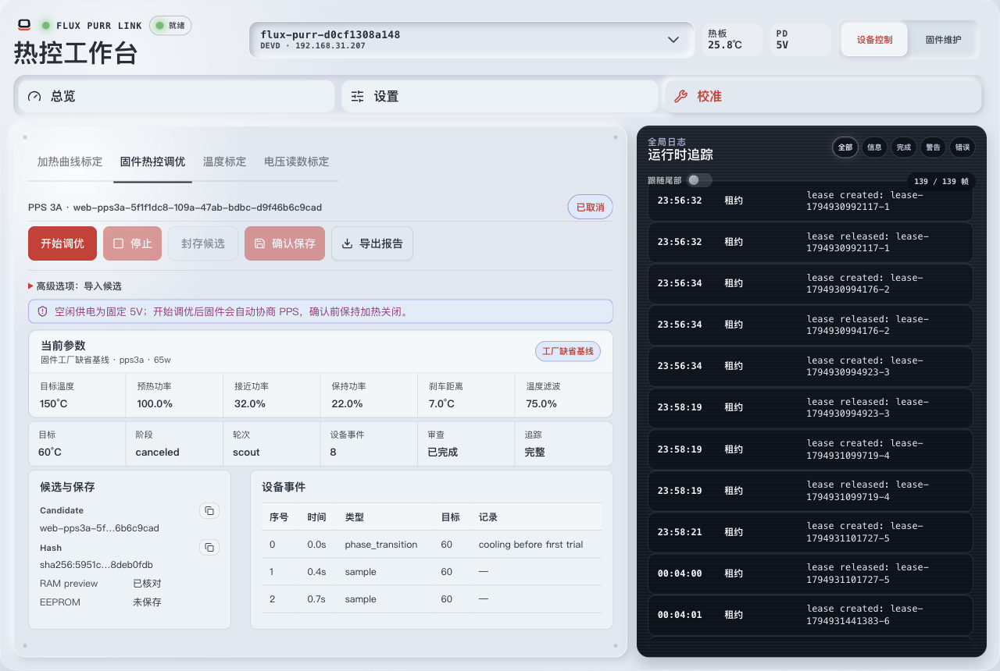

# LAN 设备会话与固件热控调优读取

> 本文冻结真实 Web 控制台在 LAN 设备连接、配对凭据复用、固件热控调优读取和写入租约之间的长期行为契约；当前实现覆盖见 `./IMPLEMENTATION.md`，生命周期与兼容性背景见 `./HISTORY.md`。

## Context and Scope

- Context: 设备状态和实时温度已经能够通过 LAN 读取，但固件热控调优页面仍把单个调优读取失败错误显示成设备连接失败。
- In scope: 浏览器 direct LAN session、设备身份与网络地址关系、配对凭据恢复、`/api/v1/thermal-tuning` GET/POST、能力声明、错误分类、调优页面状态和有限重试。
- Out of scope: LAN 初始 WiFi provisioning、固件烧录、热控算法本身、云端服务和 WAN 控制。

## Terms and Interfaces

- `deviceId`: 设备稳定身份；同一物理设备在 DHCP 地址变化后仍保持不变。
- `baseUrl`: 当前网络定位地址；它决定请求发往哪里，不代表设备身份，也不单独决定是否需要重新配对。
- `pairing credential`: 设备通过物理配对产生的 bearer 凭据；它按设备身份复用，不因正常地址更新而重复索取。
- `device connection`: 浏览器已经验证目标设备身份，并能读取基础身份、网络或运行态事实的状态。
- `tuning read state`: 固件热控调优页面针对最近一次调优读取操作的状态；它不改变顶部设备连接状态。
- `control lease`: 允许修改设备控制输入的短生命周期租约；只读请求不因缺少租约而失败。
- `factory default thermal control baseline`: 固件内置、可独立用于受控加热和调优启动的完整热控参数集合；当前按 `pps3a` 与 `pps5a` 两个供电功率档位提供。
- `resolved tuning profile`: 根据已确认的供电功率档位，从设备标定数据或对应工厂缺省基线解析出的本次调优起点；它不是用户上传文件，也不是已保存结果。
- Interface: firmware `/api/v1/identity`, `/api/v1/status`, `/api/v1/thermal-tuning`, `/health`, `/api/v1/pairing/claim`; Web `lan-client.ts` and `FirmwareTuningWorkspace`.

## Requirements

### REQ-LTR-001 Identity and locator separation

- The system MUST treat `deviceId` as the stable device identity and `baseUrl` as a replaceable network locator.
- A saved LAN session MUST be associated with the device identity and retain its current verified `baseUrl`; a locator change MUST NOT by itself require a new four-digit pairing.
- The client MUST first use anonymous `/health` to compare the device identity at a new locator, then use the saved bearer to probe authenticated identity and status before replacing the stored locator or enabling normal operation.
- A locator that identifies a different device MUST never receive the saved bearer; the old device session remains preserved until the operator resolves the mismatch.
- covers: `VER-LTR-001`, `VER-LTR-002`

### REQ-LTR-002 Pairing credential lifecycle

- The client MUST reuse a valid saved pairing credential for the same verified device across page reloads and repeated connections.
- The client MUST show a pairing action only when no credential exists for the selected device, the device returns HTTP `401`/`unauthorized`, or the operator explicitly chooses to pair again.
- A lease expiry, tuning read failure, protocol error, or browser private-network error MUST NOT by itself delete the credential or open a pairing dialog.
- covers: `VER-LTR-003`, `VER-LTR-004`

### REQ-LTR-003 Independent connection and tuning states

- The top-level device connection state MUST remain connected when identity/status/temperature reads succeed, even if `/api/v1/thermal-tuning` fails.
- The tuning page MUST expose an internal read state with at least `idle`, `loading`, `ready`, `unsupported`, `unauthorized`, `transport_error`, and `protocol_error` outcomes.
- The tuning read state MUST be rendered in the tuning workspace and MUST NOT become a second top-level connection badge.
- covers: `VER-LTR-005`, `VER-LTR-006`

### REQ-LTR-004 Thermal-tuning capability contract

- Firmware that exposes `/api/v1/thermal-tuning` through either USB JSONL or LAN HTTP MUST advertise the `thermal_tuning` capability in `Identity.capabilities`.
- A firmware build that does not expose the route MUST return a stable HTTP error envelope with code `thermal_tuning_unsupported` for that route; it MUST NOT return a generic network or pairing error.
- The Web client MUST display “固件未提供热控调优接口” only when the capability is absent or the stable unsupported code is received.
- covers: `VER-LTR-007`, `VER-LTR-008`

### REQ-LTR-005 Read and write authorization boundary

- `GET /api/v1/thermal-tuning` MUST require a valid bearer but MUST NOT require an active control lease, create a lease, renew a lease, or change device control state.
- `POST /api/v1/thermal-tuning` MUST require a valid bearer. Start, seal, and confirm-save MUST require an active control lease and preserve the existing revision and safety checks for mutations.
- Authenticated `cancel` MUST be an idempotent safety-stop exception: it MUST NOT acquire or require a mutation lease or optimistic revision, and MUST NOT depend on a preliminary status read. Repeated stop MUST preserve an already disarmed terminal result and its trace.
- The same boundary MUST hold for the corresponding `devd` and Web Serial adapters: reads are read-only, safety stop remains available without write ownership, and all other tuning mutations remain lease-protected.
- covers: `VER-LTR-009`, `VER-LTR-010`

### REQ-LTR-006 Typed endpoint error mapping

- The transport layer MUST preserve the operation name, endpoint path, HTTP status when available, protocol error code when available, and retryability classification.
- The client MUST distinguish `unauthorized`, `thermal_tuning_unsupported`, `transport_unavailable`, `server_retryable`, and `response_invalid` outcomes.
- A browser `TypeError` MUST NOT be translated unconditionally into a private-network permission failure; the message MUST state that the tuning read did not complete and MUST include the available diagnostic detail.
- A tuning failure MUST NOT be rewritten as “无法连接 LAN 设备” when the same session has already proved that identity and status reads work.
- covers: `VER-LTR-011`, `VER-LTR-012`

### REQ-LTR-007 Bounded polling and explicit retry

- The tuning page MUST perform at most three automatic retries for a retryable tuning read, using bounded backoff and a finite overall window.
- After the automatic retry budget is exhausted, the page MUST stop polling, retain the last successful tuning snapshot if one exists, and provide a visible manual “重试读取” action.
- Unsupported, unauthorized, and invalid-response outcomes MUST stop automatic polling immediately; only `401` may offer a re-pair action, and only the unsupported outcome may offer a firmware compatibility explanation.
- covers: `VER-LTR-013`, `VER-LTR-014`

### REQ-LTR-008 User-facing error language

- The tuning page MUST name the failed operation and explain the next safe action.
- Required message categories are: `设备已连接，但固件调优读取未完成`, `设备拒绝了当前配对凭据，请重新配对`, `当前固件未提供热控调优接口`, `设备返回的数据格式无效`, and `读取暂时失败，可重试`.
- The page MUST never request pairing for a transport-only failure and MUST never claim that the device is disconnected when status and temperature remain readable.
- covers: `VER-LTR-015`, `VER-LTR-016`

### REQ-LTR-009 Diagnostic trace integrity

- Each tuning read attempt MUST emit a bounded diagnostic event containing device identity, operation, endpoint, result category, retry count, and HTTP status or protocol code when available.
- Bearer tokens, four-digit pairing codes, passwords, and full authorization headers MUST be redacted before the event reaches the UI log, export, or persisted history.
- The event stream MUST make it possible to distinguish a successful status read followed by a failed tuning read.
- covers: `VER-LTR-017`

### REQ-LTR-010 Transport parity

- Direct LAN, `devd` LAN bridge, `devd` USB, and Web Serial MUST expose the same tuning domain states and error categories, even when their wire mechanisms differ.
- A transport adapter MUST not report capability or lease errors that belong to another adapter.
- USB response backpressure or transport recovery MUST NOT prevent the runtime from draining the LAN control mailbox. Runtime dispatch MUST remain serialized: a newly processed USB command consumes that iteration's command budget, while transmission of a previous reply does not.
- The public Demo build MUST keep these behaviors mockable without opening LAN, Web Serial, or `devd` connections.
- covers: `VER-LTR-018`, `VER-LTR-019`

### REQ-LTR-011 USB-assisted LAN authentication

- An authorized USB/devd lease MAY establish LAN authentication without user-entered pairing code.
- Firmware MUST expose this operation only on the USB control channel and MUST persist or reuse the device bearer internally.
- devd MUST bind the resulting credential to the verified USB `deviceId`, retain the `flux-purr-<deviceId>.local` hostname from the verified identity, validate LAN identity/status before registering the bridge, and never serialize the bearer to Web callers or logs.
- When USB reports a current private IPv4 address, devd SHOULD prefer that locator after anonymous `/health` identity verification; mDNS remains the discovery name and fallback locator. An address reporting another device MUST NOT receive the bearer. An authenticated identity probe MUST match the USB identity before the locator is persisted.
- Web callers MUST receive only the authenticated devd bridge record and its verified locator, with the advertised mDNS hostname retained independently.

### REQ-LTR-012 Factory baseline and thermal-parameter start gate

- Firmware MUST embed exactly two complete factory default thermal control baselines: `pps3a` and `pps5a` as independently stored controller parameter banks. These names do not impose a 3A/60W/65W negotiation cap; normal negotiation and calibration use the actual source capability under ADR 0028.
- Each factory baseline MUST include the output curve or equivalent output model, thermal plant initial values, controller parameters, and safety voltage, current, and temperature limits.
- Firmware MUST select a baseline only after the power class is confirmed. An unknown power class MUST prevent tuning start and heater output; firmware MUST NOT guess or silently fall back to another power class.
- A tuning run MUST resolve either valid device calibration data or the selected factory baseline before enabling heater output. If neither source is available, the operation MUST fail with `thermal_parameters_unavailable` and keep heater output disabled.
- During an active run, an available PD service rediscovering its source without a detach or fatal fault MUST use the existing bounded 30-second recovery wait. The heater MUST remain disabled and qualification sampling MUST pause until a valid working PPS contract is confirmed; detach, unavailable service and recovery timeout MUST still terminate the run.
- For a pure-delay plant, online heat-discrepancy estimation MUST use the accepted observation window rather than a noisy pair of endpoint temperatures. PPS measurement-origin changes and unobserved intervals MUST contribute no temperature jump or elapsed time; stale corrections MUST expire, and no online correction may increase the permitted electrical power or relax qualification gates.

### REQ-LTR-013 Resolved profile precedence and persistence

- Valid device heater-curve or thermal-plant calibration data MUST take precedence over the corresponding factory baseline values when resolving a tuning profile.
- When device calibration data is absent, the selected factory baseline MUST be used without requiring a file upload or user-supplied candidate.
- Tuning changes MUST remain in RAM as a candidate until the tuning initiator explicitly confirms save. Stop, power loss, or a failed run MUST preserve the last persisted profile for that power class.
- A confirmed save MUST update only the selected power-class profile bank and MUST retain the other bank unchanged.
- For a completed result, the Web UI MUST offer Save and Discard. Save runs sealing and preview validation internally before requesting persistent save. The Save button shows a loading icon for at least one second. After the device confirms readback, the button shows a check mark for at least three seconds before the panel returns to standby, keeping the previous result available. Discard requires confirmation in a popover and clears the pending result on the device without changing the saved profile or removing the browser's diagnostic record.
- The browser MUST silently retain up to ten observed tuning runs in local storage scoped to the Web origin, including their collected status and events. The archive MUST exclude owner proofs and other authentication secrets and MUST NOT require upload or user interaction.
- The Web tuning workspace MUST plot recorded, accepted temperature samples against elapsed time for each measured target and trial, with a target reference and observed peak and overshoot. Missing evidence MUST be indicated and not interpolated across gaps. The chart MUST NOT replace device qualification or trace evidence.

### REQ-LTR-014 Tuning run ownership and cross-client writes

- A device MUST have at most one active tuning run at a time.
- While a tuning run is active, all clients MAY read device and tuning state, but all tuning writes and unrelated control writes MUST be rejected by the device and rendered disabled by the Web UI.
- Any authenticated client MAY request an idempotent stop for the active tuning run.
- Only the client that started the active tuning run MAY confirm and persist its candidate.
- Start MUST return an opaque owner proof only to its caller. Confirm-save MUST validate that proof before any persistent write; public status, trace, candidate identity and diagnostic logs MUST NOT disclose it. Stop, failure, a new run and successful save MUST invalidate the previous proof.
- The Web UI MUST show a page-level global notice while the run is active and explain which writes are disabled and that stopping remains available.
- Ordinary device status MUST expose `thermalTuningActive` independently of the tuning event stream so every workspace can observe the write interlock without acknowledging another client's events. The flag MUST NOT contain the run's owner proof; legacy status without it is decoded as inactive.

## Verification

### VER-LTR-001 Locator reconciliation fixture

- Method: Exercise a saved device session against a new `baseUrl` whose authenticated identity matches the saved `deviceId`.
- covers: `REQ-LTR-001`
- Pass condition: The locator is updated, the saved credential is reused, and no pairing dialog is shown.

### VER-LTR-002 Identity mismatch fixture

- Method: Exercise a saved session against a locator that reports a different `deviceId`.
- covers: `REQ-LTR-001`
- Pass condition: The bearer is not sent to the mismatched device, the old record remains intact, and the UI requests an explicit resolution.

### VER-LTR-003 Reload and reconnect fixture

- Method: Pair once, reload the page, and reconnect the same device at the same or verified new locator.
- covers: `REQ-LTR-002`
- Pass condition: The saved credential is reused without a second pairing code.

### VER-LTR-004 Authorization invalidation fixture

- Method: Return HTTP `401` from a previously paired device.
- covers: `REQ-LTR-002`
- Pass condition: Only the affected device credential becomes invalid, the pairing action is shown, and unrelated device records remain available.

### VER-LTR-005 Connected-with-tuning-failure fixture

- Method: Return successful `/health`, identity, status, and temperature reads followed by a failed tuning GET.
- covers: `REQ-LTR-003`
- Pass condition: The top-level device remains connected and only the tuning workspace enters an error state.

### VER-LTR-006 Tuning state rendering fixture

- Method: Replay ready, loading, unsupported, unauthorized, transport, and invalid-response tuning outcomes.
- covers: `REQ-LTR-003`, `REQ-LTR-008`
- Pass condition: Each outcome has the correct workspace message and action without changing the device connection badge incorrectly.

### VER-LTR-007 Capability parity inspection

- Method: Build firmware with `net_http` and inspect `Identity.capabilities`; build the compatible USB-only variant and inspect the same field.
- covers: `REQ-LTR-004`
- Pass condition: Every build exposing the tuning route advertises `thermal_tuning`.

### VER-LTR-008 Unsupported response fixture

- Method: Query a fixture without the tuning route.
- covers: `REQ-LTR-004`
- Pass condition: The response code is `thermal_tuning_unsupported`, the UI explains firmware compatibility, and no pairing flow opens.

### VER-LTR-009 Read authorization fixture

- Method: Send an authorized tuning GET without a lease and an unauthorized tuning GET without a bearer.
- covers: `REQ-LTR-005`
- Pass condition: The first succeeds without lease creation; the second returns `401`.

### VER-LTR-010 Write authorization fixture

- Method: Send tuning POST with no lease, an expired lease, and a valid lease.
- covers: `REQ-LTR-005`
- Pass condition: Missing or expired leases are rejected; a valid lease reaches the mutation path.

### VER-LTR-011 Error envelope mapping tests

- Method: Unit-test HTTP status, protocol code, invalid JSON, and transport exception mapping in the LAN client.
- covers: `REQ-LTR-006`
- Pass condition: Each input produces the matching typed category and preserves diagnostic fields.

### VER-LTR-012 Connected-session error isolation test

- Method: Complete status polling, then inject a tuning transport exception.
- covers: `REQ-LTR-006`
- Pass condition: The error message names tuning read failure and does not mention a disconnected LAN device or private-network permission unless independently evidenced.

### VER-LTR-013 Bounded retry test

- Method: Inject three retryable tuning failures followed by no response.
- covers: `REQ-LTR-007`
- Pass condition: Automatic attempts stop at the configured limit and no background timer remains active.

### VER-LTR-014 Manual retry test

- Method: Click “重试读取” after automatic retries stop.
- covers: `REQ-LTR-007`
- Pass condition: Exactly one new read sequence begins and the retry budget is reset for that user action.

### VER-LTR-015 Message catalog test

- Method: Snapshot the tuning workspace for each typed error category.
- covers: `REQ-LTR-008`
- Pass condition: The rendered Chinese message names the operation and next action without claiming a false connection failure.

### VER-LTR-016 Pairing prompt isolation test

- Method: Inject a transport failure and a server retryable failure after a valid session has been established.
- covers: `REQ-LTR-008`
- Pass condition: No pairing dialog or credential deletion occurs.

### VER-LTR-017 Redacted trace test

- Method: Record tuning attempts with bearer, pairing, and response metadata present.
- covers: `REQ-LTR-009`
- Pass condition: Trace entries retain endpoint diagnostics and contain none of the sensitive values.

### VER-LTR-018 Cross-transport contract fixture

- Method: Replay the same tuning outcome matrix through direct LAN, `devd` LAN, `devd` USB, and Web Serial adapters.
- Method: Keep a USB reply pending across repeated runtime iterations with a full LAN mailbox; verify that LAN requests drain, and that processing a new USB command defers LAN dispatch until the next iteration.
- covers: `REQ-LTR-010`
- Pass condition: Domain states and user-facing categories are equivalent across transports.

### VER-LTR-019 Demo isolation test

- Method: Build and run the public Demo fixture with tuning failures injected.
- covers: `REQ-LTR-010`
- Pass condition: The Demo never starts LAN, Web Serial, or `devd` activity while reproducing the same state model.

### VER-LTR-020 Factory baseline completeness and power-class gate

- Method: Inspect both firmware baseline banks and exercise tuning start with confirmed `pps3a`, confirmed `pps5a`, and unknown power class.
- covers: `REQ-LTR-012`
- Pass condition: Both banks contain complete safe parameters; the matching bank is selected for each confirmed class; unknown class prevents heater output and tuning start.

### VER-LTR-021 Calibration and factory fallback

- Method: Start tuning with valid device calibration, with calibration absent but a factory baseline present, and with both sources absent.
- covers: `REQ-LTR-012`, `REQ-LTR-013`
- Pass condition: Calibration is preferred; the factory baseline permits operation without upload; missing both returns `thermal_parameters_unavailable` and leaves heater output disabled.

### VER-LTR-022 Candidate persistence and rollback

- Method: Produce a tuning candidate, stop or fail before save, reload the device, then repeat with explicit confirmation and inspect both power-class banks.
- covers: `REQ-LTR-013`
- Pass condition: Unconfirmed results never replace persisted values; confirmed save updates only the selected bank and survives reload.

### VER-LTR-023 Cross-client tuning write gate

- Method: Start tuning from client A, attempt reads and writes from client B, stop from client B, and attempt save from both clients.
- covers: `REQ-LTR-014`
- Pass condition: Reads work; writes are rejected; client B can stop; only client A can save; the Web page shows the global active-tuning notice.

### VER-LTR-024 USB-assisted LAN authentication fixture

- Method: Acquire the authorized USB/devd session, derive the verified mDNS locator, validate LAN identity and status, and inspect all bridge and UI diagnostics.
- covers: `REQ-LTR-011`
- Pass condition: LAN authentication is established without a second pairing-code prompt; the credential remains inside firmware/devd; the Web client receives only the verified bridge record and locator.

## Related ADRs

- [ADR 0026: Separate device identity, network locator, and operation readiness](../../adr/0026-separate-device-identity-network-locator-and-operation-readiness.md)
- [ADR 0027: Embedded factory thermal baselines before tuning](../../adr/0027-embedded-factory-thermal-baselines.md)

## Visual Evidence

- 经主人授权截取的本地 Web 实机页面，1280×860，devd LAN/HTTP，显示已取消的短测与未保存状态。仅证明该空闲终态的布局和已恢复读取，不代表活动运行布局、完整调优或全部视觉门禁通过。

## References

- `./IMPLEMENTATION.md`
- `./HISTORY.md`
- [`docs/specs/real-control-plane-runtime/SPEC.md`](../real-control-plane-runtime/SPEC.md)
- [`docs/solutions/device-control/web-native-wifi-bridge-console.md`](../../solutions/device-control/web-native-wifi-bridge-console.md)
